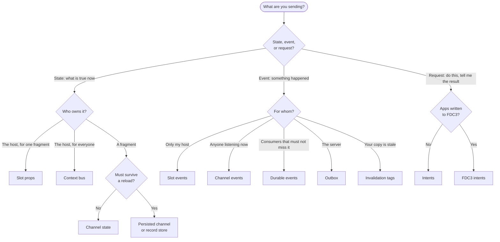
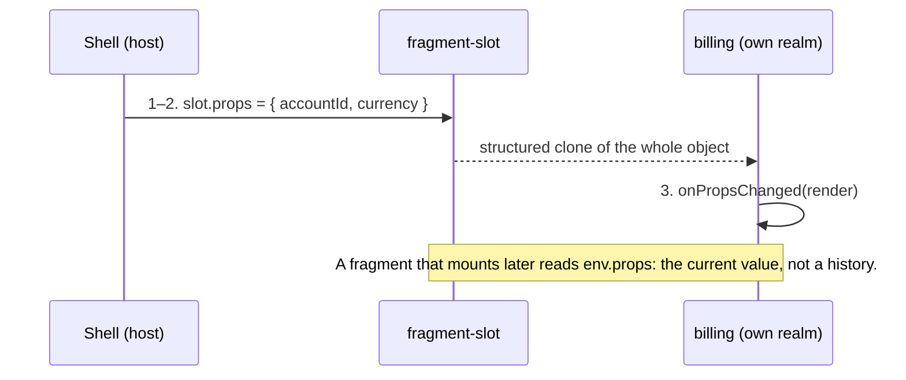
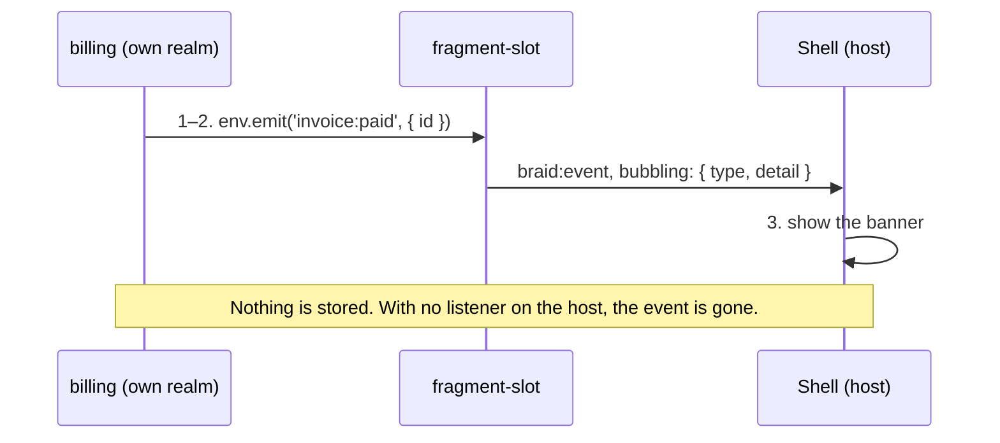
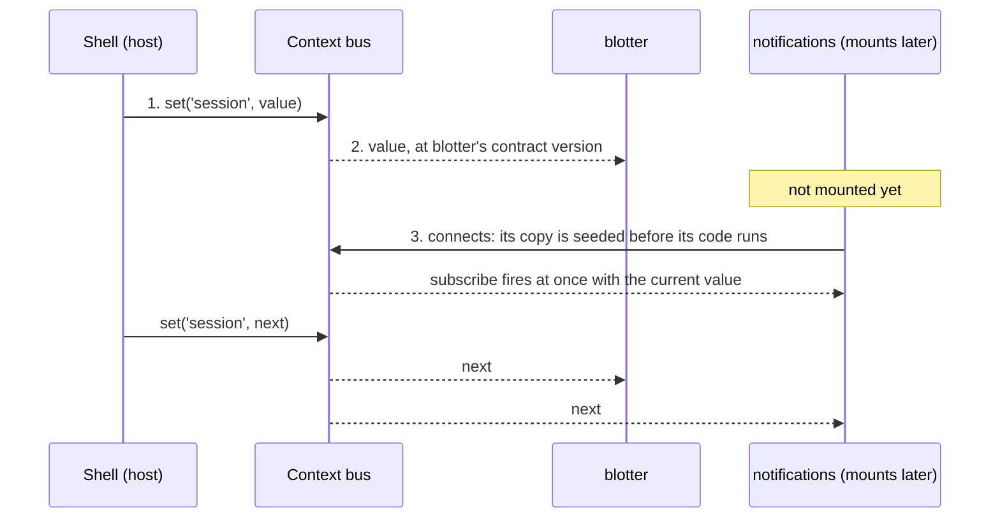
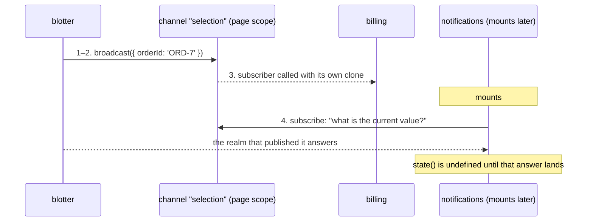
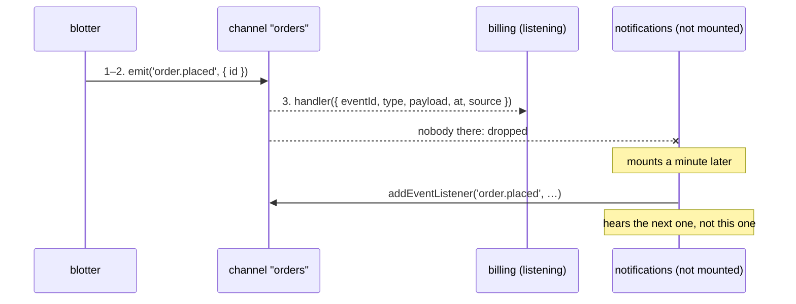
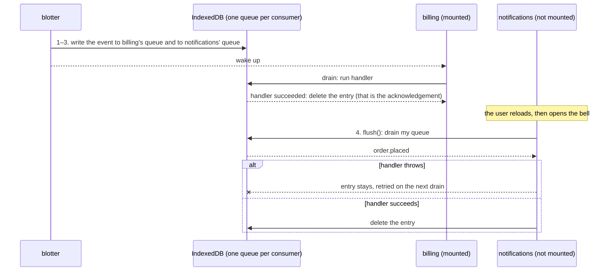
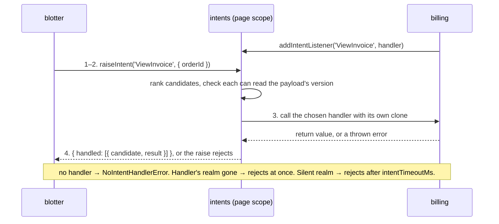
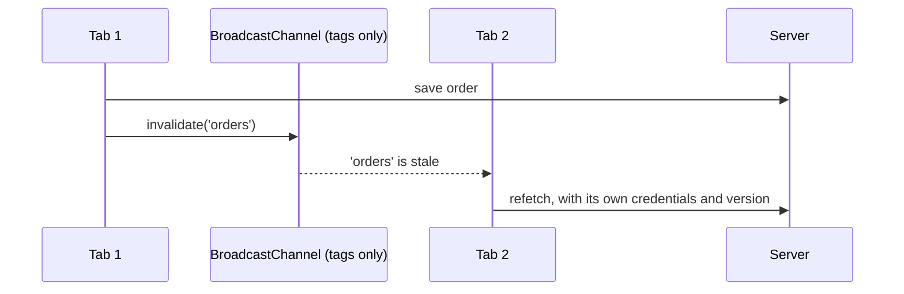
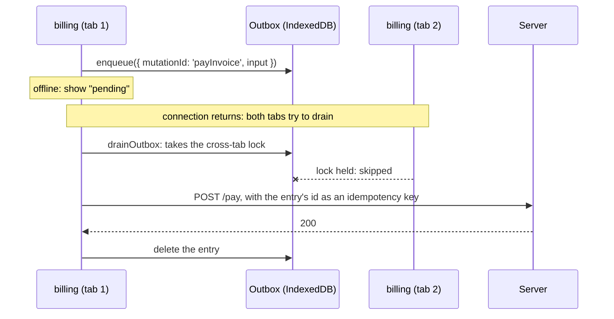

# Events and data: which mechanism

A composed page is several applications, built by different teams at different times, running in
separate JavaScript realms. They still have to tell each other things. Braid has a small set of
mechanisms for that, and each one answers a different question. This guide starts from the
problem you have and shows which one solves it, what it guarantees, and what it costs.

**The rule that decides most cases:** send *state* ("row 7 is selected") with something that keeps
the last value, and send an *event* ("the order was placed") with something that does not. Mixing
them up is the most common mistake: a late-mounting fragment either misses the state it needed,
or replays an event that already happened.

## Pick one in four questions

<MechanismChooser />

The same choice as a table:

| The problem | Use | Reaches | If the receiver is not there |
| --- | --- | --- | --- |
| The host configures one fragment | [Slot props](#host-to-one-fragment-slot-props) | that fragment | gets the current props when it mounts |
| A fragment reports to its host | [Slot events](#fragment-to-its-host-slot-events) | the host | nobody hears it |
| Every fragment needs the user, locale, theme | [Context bus](#host-to-every-fragment-the-context-bus) | every fragment the host allows | gets the current value when it mounts |
| Fragments share a selection or filter | [Channel state](#fragment-to-fragment-what-is-true-channel-state) | page, or every tab | caught up when it subscribes |
| "Order placed" — react if you are listening | [Channel events](#fragment-to-fragment-what-happened-channel-events) | page, or every tab | misses it, on purpose |
| "Order placed" — nobody may miss it | [Durable events](#an-event-nobody-may-miss-durable-events) | every registered consumer | queued on disk until it mounts |
| "Somebody open this invoice" and tell me how it went | [Intents](#ask-and-get-an-answer-intents) | one capable fragment on the page | the raise rejects |
| Sign-out, or stale data, in every tab | [Across tabs](#across-tabs) | every tab on the origin | a tab opened later reads current state |
| It must be there after a reload or a deploy | [Persisted state and records](#across-reloads-and-deploys) | this browser | read from disk, at the reader's version |
| A write the server must get, even offline | [Outbox](#to-the-server-even-offline-the-outbox) | the server | kept on disk and retried |
| A third-party widget you do not trust | [Untrusted fragments](#untrusted-fragments) | only what the host grants | gets granted context when it connects |
| Apps written to the FDC3 standard | [FDC3](#apps-written-to-a-standard-fdc3) | apps in the directory, on the page | an intent can launch the app |



## The page all the scenarios use

One portal, composed from apps owned by four teams. Read the frames as boundaries: a solid frame
is the host, a dashed frame is a trusted fragment in its own realm on the page's origin, and a
double frame is an untrusted fragment in a cross-origin frame.

<BrowserMock url="portal.example.com/orders" tabs="Orders — Portal, Billing — Portal" caption="The host shell and three trusted fragments, plus one untrusted widget. Each frame is a separate JavaScript realm.">
<Mfe name="Shell" kind="host" team="Platform team" tech="Angular">
<div class="ui-line"><span>Acme Portal</span><span class="ui-muted">Ana · en-GB · <span class="ui-btn ui-btn--ghost">Sign out</span></span></div>
<div class="bm-row">
<Mfe name="blotter" team="Trading team" tech="React" flex="2 1 240px">
<div class="ui-line is-on"><span>ORD-7 · ACME · 400</span><span class="ui-muted">selected</span></div>
<div class="ui-line"><span>ORD-8 · GLOBEX · 120</span><span class="ui-btn">Place</span></div>
</Mfe>
<Mfe name="billing" team="Billing team" tech="Vue">
<div class="ui-line"><span>Invoices for ORD-7</span></div>
<div class="ui-line"><span>INV-101 · £450</span><span class="ui-btn">Pay</span></div>
</Mfe>
</div>
<div class="bm-row">
<Mfe name="notifications" team="Platform team" tech="Lit" absent>
<span class="ui-muted">Mounted on demand, when the bell is clicked.</span>
</Mfe>
<Mfe name="vendor-analytics" kind="untrusted" team="A vendor">
<span class="ui-muted">Served from vendor.example.com.</span>
</Mfe>
</div>
</Mfe>
</BrowserMock>

Three facts about this page shape everything below:

- **Realms do not share memory.** Each trusted fragment runs in its own JavaScript realm. A
  variable, a singleton store or a `window` event in one is invisible to the others. Anything that
  crosses is a message carrying a structured clone.
- **Fragments mount at different times.** `notifications` does not exist until the bell is
  clicked. Whatever it needs must reach a fragment that arrives late.
- **Fragments are different builds.** `billing` may be a month older than `blotter`. A payload's
  shape is a contract between versions, not a type they share.

## The words this guide uses

| Word | Meaning here |
| --- | --- |
| **State** | What is true now. Only the latest value matters, and a newcomer needs it. |
| **Event** | Something that happened once. A newcomer usually must *not* get it. |
| **Request** | An event that expects one answer back: a result or an error. |
| **Reach** | How far a message travels: one slot, the page, every tab on the origin, or the server. |
| **At-most-once** | Delivered zero or one times. Nothing is stored; a receiver that is absent, or whose handler throws, loses it. |
| **At-least-once** | Stored until the receiver's handler succeeds. It can arrive twice, so the handler must be idempotent. |
| **Durable** | Written to disk (IndexedDB), so it outlives a reload, a crash and a closed tab. |
| **Late subscriber** | A fragment that mounts after the message was sent. |
| **Skew** | Sender and receiver are different builds and disagree about a payload's shape. |

There is no exactly-once delivery in a browser, as anywhere else. What you can have is
at-least-once delivery plus a handler that is safe to run twice.

---

## Host to one fragment: slot props

**The problem.** The shell knows which account is open. The `billing` fragment it placed needs to
know too, and needs to hear when it changes.

<BrowserMock url="portal.example.com/billing" caption="The host owns the value. The fragment gets a copy.">
<Mfe name="Shell" kind="host" tech="Angular">
<div class="ui-line"><span>Account <strong>ACC-99201</strong></span><span><span class="step">1</span><span class="ui-btn ui-btn--ghost">Switch account</span></span></div>
<span><span class="step">2</span><span class="msg">props = { accountId: 'ACC-44012', currency: 'GBP' }</span> ↓</span>
<Mfe name="billing" team="Billing team" tech="Vue">
<div class="ui-line"><span><span class="step">3</span>Invoices for <strong>ACC-44012</strong></span></div>
</Mfe>
</Mfe>
</BrowserMock>



```ts
// host — the element, or the same thing through a framework binding
document.querySelector('fragment-slot[name="billing"]').props = { accountId: 'ACC-44012', currency: 'GBP' };
// React:   <BraidFragment name="billing" props={{ accountId, currency }} />
// Angular: <braid-fragment name="billing" [props]="{ accountId: account(), currency: 'GBP' }" />

// fragment
import { defineFragment } from '@braidlabs/core';

defineFragment({
  mount(env) {
    render(env.props);
    env.onPropsChanged(render);
  },
});
```

| | |
| --- | --- |
| Direction | Host to the one fragment in that slot |
| Kind | State. The object is replaced whole; there are no partial updates |
| Timing | Asynchronous. Setting `props` returns before the fragment has seen it |
| Late subscriber | Covered: `env.props` is the current value at mount |
| Durability | None. The host sets it again after a reload |
| Payload | Structured clone: no functions, DOM nodes or class instances |
| Trust | Works for trusted and untrusted fragments |

**Use it when** the value belongs to the host and concerns one fragment. **Do not** pass callbacks
(they cannot be cloned) or use props for something every fragment needs: that is context.

A fragment mounted in compat mode — an unmodified app with no Braid code in it — has no `env`. It
uses the page-wide mechanisms below, which need nothing from the host.

---

## Fragment to its host: slot events

**The problem.** The user pays an invoice inside `billing`. The shell that placed it wants to show
a confirmation banner.

<BrowserMock url="portal.example.com/billing" caption="The event goes up to the element that placed the fragment, and bubbles from there like any DOM event.">
<Mfe name="Shell" kind="host" tech="Angular">
<div class="ui-banner"><span class="step">3</span>Payment received for INV-101 (£450)</div>
<span>↑ <span class="step">2</span><span class="msg">braid:event { type: 'invoice:paid', detail: { id: 'INV-101' } }</span></span>
<Mfe name="billing" team="Billing team" tech="Vue">
<div class="ui-line"><span>INV-101 · £450</span><span><span class="step">1</span><span class="ui-btn">Pay</span></span></div>
</Mfe>
</Mfe>
</BrowserMock>



```ts
// fragment
env.emit('invoice:paid', { id: 'INV-101', amount: 450 });

// host
slot.addEventListener('braid:event', (event) => {
  const { type, detail } = event.detail;
  if (type === 'invoice:paid') showBanner(detail);
});
// React:   <BraidFragment name="billing" onFragmentEvent={({ type, detail }) => …} />
// Angular: <braid-fragment name="billing" (fragmentEvent)="onEvent($event)" />
```

A fragment that is a custom element lists its own DOM events in its manifest (`"events":
["rating:change"]`) and they are forwarded the same way, with no Braid code in the element.

| | |
| --- | --- |
| Direction | Fragment to its host only. Sibling fragments do not hear it |
| Kind | Event, at-most-once |
| Timing | Asynchronous, and fire-and-forget: `emit` returns nothing |
| Late subscriber | Not covered. A listener added later hears only later events |
| Durability | None |
| Trust | Works for trusted and untrusted fragments. Treat `detail` from an untrusted one as input to validate |

**From an unmodified app.** A compat fragment has no `env` to emit with. Braid delivers the events
it dispatches on its `window` to its own shadow root, so an event marked `composed` crosses into
the host's DOM and bubbles from the slot like any other; without `composed` it stops at the shadow
root. It arrives as itself, not as `braid:event`, and its `detail` is the fragment's object, not a
copy.

```ts
// fragment, compat mode
window.dispatchEvent(new CustomEvent('invoice-paid', { detail: { id: 'INV-101' }, bubbles: true, composed: true }));

// host
slot.addEventListener('invoice-paid', (event) => showBanner(event.detail));
// Angular: <braid-fragment name="billing" (invoice-paid)="onPaid($event)" />  — a name without a colon
// React:   no prop for it; addEventListener on a ref to an element around <BraidFragment>
```

This is for trusted fragments only: an untrusted one runs in a frame and shares no DOM with the
host. [Tutorial step 4](./tutorial/04-props-and-events.md) builds it.

**Bidirectional, the simple way.** Props down and events up is a complete two-way conversation
between a host and one fragment, and it is the right default for parent and child. Reach for
[intents](#ask-and-get-an-answer-intents) only when you need the answer tied to the question.

---

## Host to every fragment: the context bus

**The problem.** Every fragment needs the signed-in user and the locale. `notifications` mounts a
minute after the page loads and needs them just the same.

<BrowserMock url="portal.example.com/orders" caption="One value, set once by the host. Every fragment reads it, including the one that mounts late.">
<Mfe name="Shell" kind="host" tech="Angular">
<span><span class="step">1</span><span class="msg">braidContext.set('session', { userId: 'ana', locale: 'en-GB' })</span></span>
<div class="bm-row">
<Mfe name="blotter" tech="React"><span><span class="step">2</span>Signed in as <strong>ana</strong></span></Mfe>
<Mfe name="billing" tech="Vue"><span><span class="step">2</span>Prices in <strong>en-GB</strong></span></Mfe>
<Mfe name="notifications" tech="Lit"><span><span class="step">3</span>Mounted later: still gets <span class="msg msg--ok">session</span> at once</span></Mfe>
</div>
</Mfe>
</BrowserMock>



```ts
// host
import { braidContext } from '@braidlabs/core';
braidContext.set('session', { userId: 'ana', locale: 'en-GB' });

// any fragment: the current value now, then every change
env.context.subscribe('session', (session) => signIn(session));
```

Register a `@braidlabs/skew` schema for a key (`braidContext.register('session', SessionSchema)`)
and each fragment receives the value projected to the version it declares with `{ as: 1 }`. An
older fragment gets the older shape, and a chain that cannot be projected is refused when the
fragment subscribes, not in the middle of a broadcast.

| | |
| --- | --- |
| Direction | Host to fragments. Fragments read; they do not write |
| Kind | State, last value per key |
| Timing | The replay inside `subscribe` is synchronous. Later changes reach a fragment's realm as messages |
| Late subscriber | Covered. This is what the bus is for |
| Durability | None. The host sets it again after a reload |
| Skew | Per-subscriber projection, when a schema is registered |
| Trust | An untrusted fragment reads only the keys the host grants it |

**Use it when** the host is the source of truth. **Do not** use it for fragment-to-fragment
traffic: fragments cannot publish to it, by design.

---

## Fragment to fragment, what is true: channel state

**The problem.** Selecting an order in `blotter` should show that order's invoices in `billing`.
Neither team wants to depend on the other, and the shell should not be in the middle.

<BrowserMock url="portal.example.com/orders" caption="Sibling fragments share state through a named channel. Neither imports the other.">
<Mfe name="Shell" kind="host" tech="Angular">
<div class="bm-row">
<Mfe name="blotter" team="Trading team" tech="React">
<div class="ui-line is-on"><span><span class="step">1</span>ORD-7 · ACME</span><span class="ui-muted">clicked</span></div>
<span><span class="step">2</span><span class="msg">selection.broadcast({ orderId: 'ORD-7' })</span> →</span>
</Mfe>
<Mfe name="billing" team="Billing team" tech="Vue">
<div class="ui-line"><span><span class="step">3</span>Invoices for <strong>ORD-7</strong></span></div>
</Mfe>
<Mfe name="notifications" tech="Lit">
<span><span class="step">4</span>Mounts later, asks, and is told <span class="msg msg--ok">ORD-7</span></span>
</Mfe>
</div>
</Mfe>
</BrowserMock>



```ts
import { createEventBus } from '@braidlabs/data';

// in each fragment, with its own name
const bus = createEventBus({ consumer: 'blotter' });
const selection = bus.channel<{ orderId: string }>('selection'); // scope: 'page' by default

selection.broadcast({ orderId: 'ORD-7' });          // blotter
selection.subscribe(({ orderId }) => load(orderId)); // billing: the current value now, then changes
```

| | |
| --- | --- |
| Direction | Any fragment to every other. Any of them may publish |
| Kind | State. Last value wins |
| Timing | `broadcast` returns at once. Other realms hear it asynchronously, over a `BroadcastChannel` |
| Late subscriber | Covered, asynchronously: it asks the realms already there, and `subscribe` fires when one answers |
| Ordering | Per publisher. Two publishers that disagree raise a conflict you can read with `conflict()`; pick a policy with `onConflict` |
| Durability | None by default. `persist: true` keeps it across reloads ([below](#across-reloads-and-deploys)) |
| Skew | `bus.register(name, schema)` projects per subscriber, as the context bus does |
| Trust | Trusted fragments only. An untrusted fragment is not reached |

**Use it when** the state belongs to a fragment, or to nobody in particular. **Give the channel
one writer** where you can: a channel two fragments both write to needs a conflict policy.

For several instances of one shape — a selection per fund, say — open the channel per entity:
`bus.channel('selection', { entity: 'fund:f1' })`. State does not cross between entities.

---

## Fragment to fragment, what happened: channel events

**The problem.** When an order is placed, the `billing` fragment should refresh, and a toast
should appear if `notifications` happens to be open. If it is not open, nothing should be shown
later: a toast for an order placed ten minutes ago is a bug.

<BrowserMock url="portal.example.com/orders" caption="An event is heard by whoever is listening at that moment, and by nobody afterwards.">
<Mfe name="Shell" kind="host" tech="Angular">
<div class="bm-row">
<Mfe name="blotter" team="Trading team" tech="React">
<div class="ui-line"><span>ORD-8 · GLOBEX</span><span><span class="step">1</span><span class="ui-btn">Place</span></span></div>
<span><span class="step">2</span><span class="msg">orders.emit('order.placed', { id: 'ORD-8' })</span> →</span>
</Mfe>
<Mfe name="billing" team="Billing team" tech="Vue">
<div class="ui-line"><span><span class="step">3</span>Refreshing invoices…</span></div>
</Mfe>
<Mfe name="notifications" tech="Lit" absent>
<span><span class="msg msg--off">order.placed</span> Not listening, so never told.</span>
</Mfe>
</div>
</Mfe>
</BrowserMock>



```ts
const orders = bus.channel('orders');

await orders.emit('order.placed', { id: 'ORD-8' });      // blotter
orders.addEventListener('order.placed', ({ payload }) => refresh(payload.id)); // billing
```

| | |
| --- | --- |
| Direction | Any fragment to every listener |
| Kind | Event, at-most-once by default |
| Timing | Asynchronous. Handlers in the emitting realm start at once; other realms hear it as a message |
| Late subscriber | Not replayed, deliberately |
| Ordering | Events from one emitter arrive in the order it sent them. There is no order across emitters |
| Failure | A handler that throws is reported to `onEventError` and not retried. One bad handler does not stop the others |
| Durability | None |
| Trust | Trusted fragments only |

**The test for state versus event:** would a fragment that mounts in five minutes need this? If
yes, it is state — `broadcast` it. If it would be wrong to act on it then, it is an event.

---

## An event nobody may miss: durable events

**The problem.** When an order is placed, `notifications` must record it in the user's inbox —
even though `notifications` is not mounted, and even if the user reloads before opening it.

<BrowserMock url="portal.example.com/orders" caption="A durable event is written once per consumer, to that consumer's own queue on disk.">
<Mfe name="Shell" kind="host" tech="Angular">
<div class="bm-row">
<Mfe name="blotter" team="Trading team" tech="React">
<div class="ui-line"><span>ORD-8 · GLOBEX</span><span><span class="step">1</span><span class="ui-btn">Place</span></span></div>
<span><span class="step">2</span><span class="msg">emit('order.placed', …, { delivery: 'at-least-once' })</span></span>
</Mfe>
<Mfe name="notifications" tech="Lit" absent>
<span><span class="step">4</span>Mounts later, drains its queue, handles <span class="msg msg--ok">order.placed</span></span>
</Mfe>
</div>
<div class="ui-disk"><span class="step">3</span>IndexedDB · queue for <strong>billing</strong>: [order.placed] · queue for <strong>notifications</strong>: [order.placed]</div>
</Mfe>
</BrowserMock>



```ts
import { createEventBus, indexedDbRecordDriver, EVENT_BUS_COLLECTIONS } from '@braidlabs/data';

const driver = indexedDbRecordDriver({ database: 'portal', collections: [...EVENT_BUS_COLLECTIONS] });
const bus = createEventBus({
  consumer: 'notifications',
  driver,
  // everyone who may consume a durable event: a queue is written for each, mounted or not
  consumers: ['billing', 'notifications'],
});
const orders = bus.channel('orders');

// emitter: resolves once the event is written to every consumer's queue
await orders.emit('order.placed', { id: 'ORD-8' }, { delivery: 'at-least-once' });

// consumer: register the handler, then drain what queued while it was away
const seen = new Set<string>();
orders.addEventListener('order.placed', async ({ eventId, payload }) => {
  if (seen.has(eventId)) return; // delivered twice is allowed: make it harmless
  await addToInbox(payload);
  seen.add(eventId);
});
await bus.flush();
```

What "at-least-once" means here, precisely:

- **The acknowledgement is your handler returning.** The entry is deleted when every handler for
  it has resolved. A handler that throws or rejects leaves it queued.
- **It can arrive twice.** A tab that crashes after the handler ran and before the entry was
  deleted will see it again. Every event carries a stable `eventId`; record the ones you have
  handled, or make the handler idempotent by nature ("set status to placed", not "add one").
  The `Set` above only dedupes within one page load: keep handled ids in a record store if a
  repeat after a reload would do harm.
- **One queue per consumer.** A consumer whose handler keeps failing blocks only itself. The
  others are not held up behind it.
- **In order, one at a time, per consumer.** A queue drains oldest first and stops at the first
  failure, so a later event never overtakes an earlier one that has not been handled. Across
  tabs, a lock makes sure only one of them drains a consumer's queue at a time.
- **Register every handler before you drain.** A consumer has one queue for all its channels. An
  entry whose event type has no handler registered counts as a failure: it stays, it is reported,
  and everything behind it for that consumer waits. Add all your listeners at start-up, then call
  `flush()`.
- **It gives up loudly, not silently.** An entry is abandoned after `maxAttempts` failed deliveries
  (5 by default). Each is reported to `onEventError`.
- **Retention is enforced when the next event is written, not by a clock.** Each emit first drops
  that consumer's entries on the channel that are older than `ttlMs` (one hour by default), and
  the oldest ones beyond `maxDepth` (500 by default), reporting each. So a stale entry is removed
  by the next emit on its channel; if nothing more is emitted, it is still delivered when the
  consumer drains. Treat `ttlMs` as a storage bound, and have a handler check `event.at` itself if
  acting on an old event would be wrong.
- **Unknown consumers get nothing.** A queue is written for each name in `consumers`. A fragment
  not on the list is not waited for, because a queue cannot wait for a reader it does not know
  exists.
- **No driver, no durability.** Without a `driver` the emit is refused rather than quietly
  downgraded to at-most-once.

| | |
| --- | --- |
| Kind | Event, at-least-once |
| Timing | Asynchronous. `emit` resolves when the event is on disk, not when it has been handled |
| Late subscriber | Covered: delivered when the consumer next mounts and drains |
| Durability | IndexedDB, per origin and tenant partition. Survives reload, crash and a closed tab. Does not leave this browser |
| Cost | One copy of the payload per consumer, and a handler you must write to be idempotent |

**Use it when** missing the event would be a defect. **Do not** use it for anything a late
fragment should ignore, or as a way to reach a server: that is the [outbox](#to-the-server-even-offline-the-outbox).

---

## Ask and get an answer: intents

**The problem.** `blotter` wants "somebody open the invoice for this order" and needs to know
whether it worked. It should not know which fragment does it — today `billing`, next quarter a
replacement.

<BrowserMock url="portal.example.com/orders" caption="A request names what should happen, not who should do it. The answer comes back to the caller.">
<Mfe name="Shell" kind="host" tech="Angular">
<div class="bm-row">
<Mfe name="blotter" team="Trading team" tech="React">
<div class="ui-line is-on"><span>ORD-7 · ACME</span><span><span class="step">1</span><span class="ui-btn">View invoice</span></span></div>
<span><span class="step">2</span><span class="msg">raiseIntent('ViewInvoice', { orderId: 'ORD-7' })</span> →</span>
<span><span class="step">4</span>← <span class="msg msg--ok">{ opened: 'INV-101' }</span></span>
</Mfe>
<Mfe name="billing" team="Billing team" tech="Vue">
<div class="ui-line is-on"><span><span class="step">3</span>INV-101 · £450 · opened</span></div>
</Mfe>
</div>
</Mfe>
</BrowserMock>



```ts
// billing
bus.addIntentListener('ViewInvoice', {
  handler: async ({ orderId }) => ({ opened: await openInvoiceFor(orderId) }),
});

// blotter
try {
  const { handled } = await bus.raiseIntent('ViewInvoice', { orderId: 'ORD-7' });
  toast(`Opened ${handled[0].result.opened}`);
} catch (error) {
  toast('Nothing on this page can open invoices'); // NoIntentHandlerError, or the handler's own error
}
```

| | |
| --- | --- |
| Direction | One caller to one handler (or all of them, with `resolve: 'all'`), and back |
| Kind | Request and response |
| Timing | Asynchronous. A handler in another realm must answer within `intentTimeoutMs`, 30 seconds by default |
| Late subscriber | Not covered. With no handler, the raise rejects; a raise in a bus's first 100 ms waits once for the others to announce themselves |
| Delivery | At-most-once. An intent is not queued or retried; retry in the caller if it is safe to |
| Skew | Decided where the intent is raised: a handler that cannot read the payload's version is not offered it |
| Payload | Arguments, results and errors cross as structured clones. An error arrives as its message |
| Reach | This page only. A handler in another tab is not a candidate |
| Trust | Trusted fragments only, and they trust each other: a call to a handler is code running on the caller's behalf |

**Intents or events?** If the sender does not care whether anyone acted, emit an event. If it
needs to know that it was done, or needs a value back, raise an intent.

---

## Across tabs

Two different problems hide under "tell the other tabs", and they want different tools.

### Everyone must agree: origin-scoped channels

**The problem.** The user signs out in one tab. Every other tab must stop showing their data.

<div class="bm-pair">
<BrowserMock url="portal.example.com/orders" tabs="Orders — Portal" caption="Tab 1">
<Mfe name="Shell" kind="host">
<div class="ui-line"><span>Ana</span><span><span class="step">1</span><span class="ui-btn ui-btn--ghost">Sign out</span></span></div>
<span><span class="step">2</span><span class="msg">session.broadcast({ signedIn: false })</span></span>
</Mfe>
</BrowserMock>
<BrowserMock url="portal.example.com/billing" tabs="Billing — Portal" caption="Tab 2, and a tab opened later">
<Mfe name="Shell" kind="host">
<div class="ui-banner ui-banner--warn"><span class="step">3</span>You have been signed out.</div>
<span class="ui-muted"><span class="step">4</span>A tab opened afterwards asks, and is told the same.</span>
</Mfe>
</BrowserMock>
</div>

```ts
// reach is chosen per channel: a selection is page state, a sign-out is origin-wide
const session = bus.channel<{ signedIn: boolean }>('session', { scope: 'origin' });

session.broadcast({ signedIn: false });                       // the tab where it happened
session.subscribe(({ signedIn }) => signedIn || lockScreen()); // every tab, and any opened later
```

It is state, not an event, so that a tab opened a moment later still learns it. With no other tab
alive to answer, a fresh tab starts from nothing — which is why the sign-out itself must also
clear what is stored (`createTenancy(...).signOut()`).

### Your copy is stale: invalidation tags

**The problem.** An order is edited in one tab. A list in another tab is now out of date. It does
not need the new order pushed to it; it needs to know to refetch.



```ts
import { sharedInvalidator } from '@braidlabs/data';

// crossContext is off by default: turn it on to reach other realms and tabs
const invalidator = sharedInvalidator({ partition: 'tenant_acme', crossContext: true });

invalidator.invalidate('orders');                         // where the write happened
invalidator.subscribe(() => ['orders'], () => refetch());  // wherever the list is shown
```

No data crosses, only tag names. That makes it immune to skew — each tab fetches at its own
version — and safe across tenants, because tags never leave their partition. It is at-most-once:
a tab that is not open hears nothing, and does not need to, because it will fetch when it opens.

### Only one tab should do it: locks

Work that must happen once however many tabs are open — draining a queue, refreshing a token —
takes a cross-tab lock:

```ts
import { withLock } from '@braidlabs/data';

const result = await withLock('refresh-token', () => refreshToken());
if (!result.acquired) {
  // another tab or realm is already doing it: by default this returns at once rather than waiting
}
```

| | Origin channel state | Invalidation tags | Durable events |
| --- | --- | --- | --- |
| Carries | the value | a tag name | the event |
| A tab opened later | asks the others | fetches for itself | drains its consumer's queue |
| Skew between tabs | projected, with a registered schema | none: no payload | projected, with a registered schema |
| Typical use | sign-out, theme, feature switches | lists and caches | must-not-miss events |

Not across tabs: slot props and events, the context bus, intents and FDC3 are all scoped to one
page.

---

## Across reloads and deploys

**The problem.** The user reloads. The order they had selected should still be selected. Next
week a deploy changes that selection's shape, and a tab still open from before the deploy must
keep working.

<div class="bm-pair">
<BrowserMock url="portal.example.com/orders" caption="Before the reload: build 41">
<Mfe name="blotter" tech="React · build 41">
<div class="ui-line is-on"><span><span class="step">1</span>ORD-7 selected</span></div>
<div class="ui-disk"><span class="step">2</span>stored: { v: 1, orderId: 'ORD-7' }</div>
</Mfe>
</BrowserMock>
<BrowserMock url="portal.example.com/orders" caption="After a deploy and a reload: build 42">
<Mfe name="blotter" tech="React · build 42">
<div class="ui-disk"><span class="step">3</span>read as v2: { order: { id: 'ORD-7' } }</div>
<div class="ui-line is-on"><span><span class="step">4</span>ORD-7 selected</span></div>
</Mfe>
</BrowserMock>
</div>

```ts
const driver = indexedDbRecordDriver({ database: 'portal', collections: [...EVENT_BUS_COLLECTIONS] });
const bus = createEventBus({ consumer: 'blotter', driver });

bus.register('selection', SelectionSchema);                 // a @braidlabs/skew schema: v1 → v2
const selection = bus.channel('selection', { persist: true });
selection.subscribe((value) => highlight(value));           // after a reload: what was selected before it
```

- **Restoring is asynchronous.** `state()` is `undefined` until the stored value has been read;
  `subscribe` fires when it has.
- **A stored value is a fallback.** A value broadcast since the reload, or a fresher one another
  realm holds, wins over it.
- **Register the contract first.** A value stored under a contract this build has not registered
  is reported and withheld, because its shape could belong to another version.
- **For data rather than UI state,** use `createRecordStore`: addressable records in IndexedDB,
  each read at the reader's schema version. See [`@braidlabs/data`](./packages/data.md).

The durability ladder, from least to most:

| Lives in | Survives | Mechanisms |
| --- | --- | --- |
| Memory of one realm | nothing | slot props, slot events, at-most-once events |
| Memory of the page's realms | a fragment remounting | context bus, channel state, FDC3 channels |
| Memory of every tab | one tab closing | origin-scoped channel state |
| IndexedDB in this browser | reload, crash, deploy | `persist: true`, record store, durable events, outbox |
| The gateway, per signed-in user | a different browser | workspace `serverStore` ([console](./packages/console.md)) |
| Your server | everything | whatever the outbox delivered |

---

## To the server, even offline: the outbox

**The problem.** The user pays an invoice on a train. The request must reach the server when the
connection returns, exactly one tab must send it, and the UI should show the payment as pending
in the meantime.



```ts
import { createOutbox, drainOutbox } from '@braidlabs/data';

const outbox = createOutbox({ driver, owner: 'billing' });
const entryId = await outbox.enqueue({ mutationId: 'payInvoice', input: { id: 'INV-101' } });

await drainOutbox({
  outbox,
  owner: 'billing',
  runnerFor: (mutationId) =>
    mutationId === 'payInvoice'
      ? (input, entry) => api.pay(input, { idempotencyKey: entry.id })
      : undefined,
});
```

This is at-least-once towards the server, with the same rules as durable events — it is the same
drain: oldest first, stop at the first failure, one tab at a time, abandon loudly after
`maxAttempts`. The server must treat a repeat as the same request, which is what the idempotency
key is for.

**Server to browser** is not something Braid transports. Use what you already have — fetch, SSE, a
WebSocket — in one place, and fan the result out on the page with channel state, an event, or an
invalidation tag. One connection, in the host or one fragment, is better than one per fragment.

---

## Untrusted fragments

**The problem.** A vendor's analytics widget runs on the page. It needs the locale. It must not
see the session, other fragments' traffic, or the DOM.

<BrowserMock url="portal.example.com/orders" caption="A cross-origin frame. The browser enforces the wall; Braid decides the few things that pass through it.">
<Mfe name="Shell" kind="host" tech="Angular">
<span><span class="step">1</span><span class="msg">capabilities: { 'vendor-analytics': { context: { read: ['locale'] } } }</span></span>
<div class="bm-row">
<Mfe name="blotter" tech="React">
<span><span class="msg">selection.broadcast(…)</span> page channels, intents, FDC3</span>
</Mfe>
<Mfe name="vendor-analytics" kind="untrusted" team="A vendor">
<span><span class="step">2</span><span class="msg msg--ok">locale: 'en-GB'</span> granted</span>
<span><span class="msg msg--off">session</span> never told it exists</span>
<span><span class="msg msg--off">selection</span> not reached</span>
<span><span class="step">3</span><span class="msg">session.emit('impression', …)</span> ↑ to the host only</span>
</Mfe>
</div>
</Mfe>
</BrowserMock>

```ts
// host
initBraid({
  capabilities: { 'vendor-analytics': { context: { read: ['locale'] } } },
});

// the widget, at its own origin
import { connectToBraidHost } from '@braidlabs/core';

const session = await connectToBraidHost({
  hostOrigin: 'https://portal.example.com',
  contract: { version: '1.0.0', requires: { host: '>=1.4.0' } },
});
session.context.subscribe('locale', setLocale); // granted keys only
session.emit('impression', { slot: 'sidebar' }); // arrives on the host as braid:event
```

| Mechanism | Trusted fragment | Untrusted fragment |
| --- | --- | --- |
| Slot props, slot events | yes | yes, over a pinned message port |
| Context bus | reads every key | reads only granted keys; an ungranted key sends no change notice |
| `@braidlabs/data` channels, durable events, intents | yes | no: a different origin, so a different `BroadcastChannel` and a different IndexedDB |
| FDC3 | yes, if in the directory | no |
| Shares storage with the page | yes | no |

Two consequences worth designing for:

- **The host is the only bridge.** If an untrusted fragment needs something a trusted one
  publishes, the host subscribes and passes on exactly that value, as a prop or a granted context
  key. That is a feature: the host's code is the list of what crosses.
- **Everything arriving from it is input.** Validate the `detail` of an untrusted fragment's
  events as you would a request body.

Trusted fragments, by contrast, trust each other completely: any same-origin script can write to
the page's channels and answer its intents. Channels and intents are not a security boundary.
If that is uncomfortable for a fragment, it belongs in the untrusted tier. See
[Trust tiers](./braid-boundary.md).

---

## Apps written to a standard: FDC3

**The problem.** Some of the apps on the page were written for a financial desktop and already
speak FDC3: `fdc3.broadcast`, `fdc3.raiseIntent`. They should work unchanged, next to each other
and next to your own fragments.

<BrowserMock url="portal.example.com/desk" caption="Each app gets its own window.fdc3, bound to its identity in the app directory.">
<Mfe name="Shell" kind="host" tech="runs the desktop agent">
<div class="bm-row">
<Mfe name="blotter" tech="FDC3 app">
<span><span class="step">1</span><span class="msg">fdc3.broadcast({ type: 'fdc3.instrument', id: { ticker: 'AAPL' } })</span></span>
<span><span class="step">3</span><span class="msg">fdc3.raiseIntent('ViewChart', instrument)</span></span>
</Mfe>
<Mfe name="news" tech="FDC3 app">
<span><span class="step">2</span>On the same user channel: shows <strong>AAPL</strong></span>
</Mfe>
<Mfe name="chart" tech="FDC3 app" absent>
<span><span class="step">4</span>Launched for the intent, which is held until it listens</span>
</Mfe>
</div>
</Mfe>
</BrowserMock>

```ts
// host
import { createBraidDesktopAgent } from '@braidlabs/fdc3';
const agent = createBraidDesktopAgent({ directory, container: document.querySelector('#desk')! });
initBraid({ realmGlobals: agent.realmGlobals });

// any app in the directory — standard FDC3, nothing Braid-specific
await fdc3.joinUserChannel('fdc3.channel.1');
await fdc3.broadcast({ type: 'fdc3.instrument', id: { ticker: 'AAPL' } });
const resolution = await fdc3.raiseIntent('ViewChart', instrument);
```

How it lines up with the rest of this guide:

| FDC3 | Closest Braid mechanism | The difference that matters |
| --- | --- | --- |
| `broadcast` on a user or app channel | channel state | FDC3's `broadcast` is state *and* event at once: a channel keeps the last context of each type, and an app that joins a user channel later is handed it (on an app channel it asks, with `getCurrentContext`). Do not broadcast something with a verb |
| `raiseIntent` | intents | Resolved against the app directory. With a `container`, an app that is not running is launched and the intent is held until its listener is added. Several candidates go to a resolver, which is the user's choice |
| private channels | — | A channel only the two parties hold |

| | |
| --- | --- |
| Reach | The page: one agent, its apps. Not other tabs |
| Timing | Asynchronous. A request is answered within 10 seconds or fails with a timeout; an intent has 20 seconds to be handled |
| Late subscriber | User channels: caught up with the last context on joining. App channels: `getCurrentContext()`. Intents: held for an app that is starting |
| Durability | None in the agent. Saved layouts and remembered choices are the [console workspace](./packages/console.md) |
| Trust | Trusted fragments with a directory record. Each can speak only as itself |

**Use FDC3 when** the apps are written to it, or must also run on another FDC3 desktop. **Use
`@braidlabs/data` when** they are your own fragments: it separates state from events, offers
at-least-once delivery, reaches other tabs and survives version skew, none of which FDC3 covers.
The two can run on one page.

---

## Every mechanism, side by side

| Mechanism | Direction | Kind | Reach | Delivery | Late subscriber | Durable | Skew-aware | Untrusted |
| --- | --- | --- | --- | --- | --- | --- | --- | --- |
| Slot props | host → fragment | state | one slot | latest value | yes | no | no | yes |
| Slot events | fragment → host | event | one slot | at-most-once | no | no | no | yes |
| Composed DOM event | compat fragment → host | event | the slot and its ancestors | at-most-once, synchronous | no | no | no | no |
| Context bus | host → fragments | state | page | latest value | yes | no | yes | granted keys |
| Channel state | any ↔ any | state | page or origin | latest value | yes, async | with `persist` | yes | no |
| Channel events | any → any | event | page or origin | at-most-once | no | no | yes | no |
| Durable events | any → consumers | event | origin | at-least-once | yes | yes | yes | no |
| Intents | caller ↔ handler | request | page | at-most-once, answered | no | no | yes | no |
| Invalidation tags | any → any | event | page or origin | at-most-once | n/a | no | n/a | no |
| Outbox | browser → server | request | server | at-least-once | n/a | yes | yes | no |
| FDC3 channels | app ↔ app | state + event | page | latest value | yes | no | no | no |
| FDC3 intents | app ↔ app | request | page | answered, or held | launches the app | no | no | no |

## Things that apply to all of them

### Synchronous or asynchronous

Assume asynchronous. Fragments are in different realms, so a message is a task on another event
loop turn at the earliest. Concretely:

- **Nothing has been received when the sending call returns.** Do not read another fragment's
  result on the next line. If you need to know it was acted on, that is a request: use an intent
  and await it.
- **The only synchronous deliveries are local ones:** the replay inside `subscribe` when a value
  is already held in that realm, and handlers in the emitting realm for an at-most-once event.
  Do not build on either. The same code runs with the value absent when the fragment mounts
  first, so write the "not yet" path and treat the immediate call as the fast case.
- **`await emit(...)` tells you different things.** At-most-once: nothing useful. At-least-once:
  the event is on disk. Neither means a handler ran.
- **Never block.** There is no synchronous request across realms, and a busy loop waiting for a
  reply freezes the page that would deliver it.

### Late subscribers

The page is never "fully loaded": fragments mount on scroll, on click, after a lazy route. Every
design has to say what a fragment that arrives late should see.

| It should see | Mechanism |
| --- | --- |
| What is true now | props, context, channel state, FDC3 channels |
| Nothing from before | channel events, slot events |
| Everything it missed, in order | durable events |
| Whatever it fetches itself | invalidation tags |

### Ordering

- One sender's messages to one receiver arrive in the order sent.
- There is no global order across senders. If two fragments' messages must be ordered, put a
  sequence or timestamp in the payload, or give the channel one writer.
- State is last-write-wins. A channel with two writers that disagree reports a conflict rather
  than silently picking.
- A durable queue is strictly ordered per consumer, which is why one failing entry holds the ones
  behind it for that consumer. That is head-of-line blocking, chosen on purpose and bounded by
  `maxAttempts`.

### Version skew

A page composes builds from different weeks, and a queue on disk outlives the build that wrote
it. Any payload that crosses a fragment boundary is a versioned contract.

- Register a `@braidlabs/skew` schema for the key or event type, and each reader gets the payload
  projected to the version it declares with `{ as: n }`.
- Without one, the payload is cloned and delivered as it is. That is fine while one team owns
  both ends, and a liability the day they deploy separately.
- Add fields; do not repurpose them. A reader on an old build ignores a field it does not know.

### Backpressure and volume

- Channels do not buffer. A slow subscriber does not slow the publisher; it just runs later.
- For state that changes at high frequency (a pointer position, a streaming price), publish at
  the rate the slowest consumer can render, not the rate it changes. Only the last value matters.
- Durable queues are bounded by `ttlMs` and `maxDepth`, applied each time an event is written.
  Size them from the worst case: consumers × events per hour × hours a consumer can be away.
- Payloads are cloned for every receiver. Send ids and let receivers load what they need, rather
  than sending the document.

### Failure and teardown

- A handler that throws is reported to `onEventError` and does not stop other handlers. Give
  every bus an `onEventError` so that a drop is seen.
- Tie subscriptions to the fragment's lifetime: pass `{ signal: env.signal }`, or call the
  unsubscribe each API returns. A fragment that is removed and leaves a listener behind keeps its
  realm alive.
- A realm that goes away leaves the intent directory, and raises waiting on it reject at once.
- Close a bus you created (`bus.close()`) when its fragment unmounts.

### What can be sent

Everything crosses as a structured clone: plain objects, arrays, strings, numbers, dates, maps,
sets, typed arrays. Functions, DOM nodes, class instances with methods, and promises cannot. A
value that cannot be cloned is not delivered, and the failure is reported rather than thrown.
That is also a design rule: if you want to send a callback, you want an intent.

## Combining them

Real features use two or three together. The combinations that come up most:

| Feature | Combination |
| --- | --- |
| Select a row here, show its details there, and keep it after a reload | channel state with `persist: true` |
| Place an order: update other panels now, and guarantee the inbox records it | a channel event for the panels, plus a durable event for the inbox |
| Save a form offline, then tell other tabs the list changed | outbox to the server, then an invalidation tag when the drain succeeds |
| A host-owned filter that fragments may also change | context for the value, and a slot event (or an intent) to ask the host to change it |
| An untrusted widget reacts to the selection | the host subscribes to the channel and passes the value down as a prop |
| A server push that every fragment should see | one connection in the host, re-published as channel state or an event |
| FDC3 apps and your own fragments share a selection | the host bridges: listen on the FDC3 channel, broadcast on the data channel, and the reverse |

## What to avoid

| Tempting | Why it fails | Instead |
| --- | --- | --- |
| A shared singleton store imported by every fragment | each realm gets its own copy; nothing is shared | channel state |
| `window.dispatchEvent` between fragments | each fragment has its own `window` | channel events |
| `window.postMessage` with a hand-rolled protocol | every fragment hears every message; no versioning, no late join, origin checks left to you | channels or intents |
| `localStorage` and the `storage` event as a bus | synchronous, strings only, no partitioning, fires only in *other* documents | origin-scoped channels |
| Broadcasting a command as state ("open-dialog") | replayed to every late subscriber, forever | an event or an intent |
| Emitting state as an event ("selection-changed") | a late fragment never learns the selection | channel state |
| Durable delivery "to be safe" | a late fragment acts on stale events; every handler must be idempotent | at-most-once, unless a miss is a defect |
| Passing a callback in props | cannot be cloned | a slot event up, or an intent |
| One connection to the server per fragment | N sockets, N reconnect storms | one connection, fanned out on the page |

## A checklist before you ship a new message

1. Is it state, an event, or a request? Would a fragment that mounts in five minutes need it?
2. Who owns it — the host, or a fragment? Is there one writer?
3. How far must it reach: the slot, the page, every tab, the server?
4. What happens if the receiver is not mounted? If its handler throws? If it runs twice?
5. Does it need to survive a reload? A deploy that changes its shape?
6. Is either end untrusted? Then the host is the bridge, and the payload is input to validate.
7. Is the payload small, cloneable, and versioned?
8. Where do failures go? Is `onEventError` wired to something a person will see?

## Where to go next

- [`@braidlabs/data`](./packages/data.md): channels, durable events, intents, the outbox and locks.
- [`@braidlabs/core`](./packages/core.md): slots, props, the context bus, the fragment `env`.
- [Trust tiers](./braid-boundary.md): what the untrusted boundary enforces.
- [`@braidlabs/fdc3`](./packages/fdc3.md): the desktop agent.
- [Tutorial step 4](./tutorial/04-props-and-events.md): a host and an unmodified app talking both ways, hands on.
