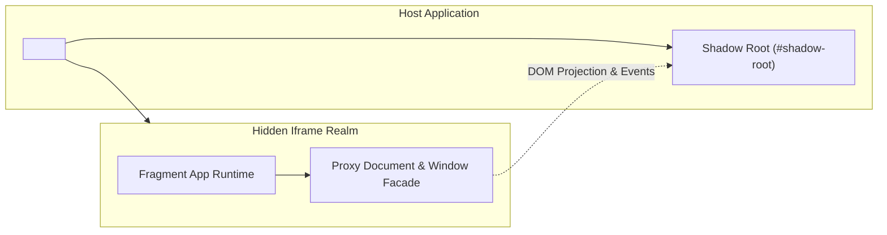

# @braidlabs/core

The foundational Braid client runtime. Compose independently deployed frontend apps into one cohesive page: one origin, one layout, and one accessibility tree, while each application retains its own isolated JavaScript realm, framework version, dependencies, and deployment schedule.

---

## Installation

```bash
npm install @braidlabs/core
```

---

## Key Primitives & Architecture



### 1. The `<fragment-slot>` Element
`<fragment-slot>` is the custom HTML element that marks insertion points in the host page. It handles:
- **Shadow Root Lifecycle:** Creates and manages open Shadow Roots (including Declarative Shadow DOM adoption from SSR piercing).
- **Realm Creation:** Spawns and manages hidden, same-origin iframe execution realms.
- **Dynamic Props & Events:** Translates host properties into the fragment and bubbles fragment events.

### 2. Execution Realms
Braid uses hidden, same-origin iframes as synchronous, DOM-capable JavaScript execution contexts:

| Realm Kind | URL Scheme | Session History Impact | Typical Use Case |
| :--- | :--- | :--- | :--- |
| `compat-http` | `/__braid/frag/:id/…` | Managed via `replaceState` | Legacy applications with zero code changes |
| `contract-blob` | `blob:` | None (Zero history pollution) | Modern contract-mode fragments |
| `sandbox` | Cross-origin URL | Isolated | Untrusted third-party widgets |

### 3. The Compat Adapter
For applications that cannot be altered during a migration, the **Compat Adapter** provides full browser emulation strictly contained inside that fragment's realm:
- **Zero Host Pollution:** Never modifies global variables (`window.*`), DOM prototypes, or listeners on the host page.
- **Document Facade:** Proxies `document.getElementById`, `querySelector`, and DOM insertions directly into the fragment's shadow root.
- **Script Neutralization:** Scripts rendered via SSR are neutralized into `<script type="inert">` so they do not execute on the host, then activated safely inside the realm.

---

## Host Integration API

Initialize Braid in your host application:

```ts
import { initBraid } from '@braidlabs/core';

// Initialize the runtime on the host page
initBraid({
  // Notify fragments on host navigation without patching host History API
  onHostNavigation: (notify) => {
    window.addEventListener('popstate', () => notify());
  },
  // Trusted fragments use the host's analytics instead of a realm-local copy
  sharedGlobals: ['dataLayer', 'adobeDataLayer', '_satellite', 'KAMPYLE'],
});
```

### Shared host globals

A compat fragment runs its JavaScript in a hidden same-origin realm. Without `sharedGlobals`, its
`window.adobeDataLayer.push(…)` goes into an array nobody watches. The usual workaround is a second
copy of the vendor script. Each listed name becomes an accessor on the fragment's realm window that
reads the host's property live and writes it back, bare identifiers included:
`var dataLayer = dataLayer || []` finds the host's array.

- **Trusted tier only.** Compat and custom-element fragments get the accessors. Untrusted
  (cross-origin) fragments ignore it, and so do contract fragments, whose host API is the contract.
- **Per fragment.** `capabilities.sharedGlobals` in the registry manifest or in
  `initBraid({ capabilities })` replaces the default. `[]` opts a fragment out.
- **Fragments can write these globals.** Initialize them on the host first.
- **It doesn't dedupe vendor scripts.** A fragment's own `<script src=".../launch.js">` still runs
  unless the fragment guards it with `if (!window._satellite)`.
- **Names the realm already defines are skipped,** with a dev-mode warning. That covers
  `location`, `document` and constructors.
- **Objects pushed from a fragment come from another realm,** so host code that checks
  `instanceof Object` on them sees `false`.
- **The accessor is configurable.** A fragment's `delete window.dataLayer` or
  `function dataLayer(){}` takes the name back into its own realm.
- **Grants ride on the realm stub,** which is cached for up to an hour. Revoking a registry grant
  reaches browsers on that schedule.

### Loading and fallback

A slot can carry host content for two moments: while its fragment boots, and if it fails.

```html
<fragment-slot name="orders" style="min-height: 320px">
  <div slot="loading" class="skeleton" aria-hidden="true" inert></div>
  <p slot="fallback">Orders are unavailable right now.</p>
</fragment-slot>
```

- **The loading content shows only while nothing of the fragment is on screen.** The slot must be
  `state="loading"` with nothing painted yet. It gives way the moment the fragment's document
  paints, which is usually before the fragment is `ready`. It also gives way on `error` (the
  fallback takes over) and on teardown. A server-rendered (pierced) fragment doesn't show it,
  because its content is already there. After `reload()`, the slot fetches afresh and can show it.
- **It suits documents that have something to show.** A fragment whose document is an empty app
  shell (`<div id="app"></div>` plus a bundle) paints that empty shell at once. The loading content
  then gives way to a blank area until the app renders. For such fragments, have the document
  carry its own skeleton inside `#app` for the app to replace, or server-render them.
- **After a delay.** It stays hidden for `--braid-loading-delay` (default `200ms`), so a fast boot
  never flashes it. Set the variable on `:root` or on one slot; `0s` shows it at once.
- **Optional.** Without a `slot="loading"` child, nothing changes. While its loading content may
  show (a client-built slot with a loading child, before first paint) the slot carries
  `aria-busy="true"`. Afterwards it puts back whatever `aria-busy` the host had set.
- **The host owns the look.**
  - Reserve the slot's size (`min-height`, `aspect-ratio`) so the swap to real content doesn't
    shift the page.
  - Mark skeletons `aria-hidden` and `inert`.
  - Keep shimmer animations inside `@media (prefers-reduced-motion: no-preference)`.
- **Before the runtime loads,** a `slot="loading"` child is ordinary light DOM and renders as
  such. Add `fragment-slot:not(:defined) > [slot] { display: none; }` to the host's CSS if it
  should wait for the runtime instead.
- **Not for untrusted fragments yet.** Their cross-origin frame doesn't show the loading slot.
- Listen to `braid:state` on the slot (it doesn't bubble) to follow every state change.

### Booting on intent

By default a slot boots its fragment as soon as it connects. `boot` defers all of it: the realm
iframe, the document fetch, and the fragment's framework and app.

```html
<fragment-slot name="reviews" boot="visible" style="min-height: 480px"></fragment-slot>
<fragment-slot name="cart" boot="interaction"></fragment-slot>
```

| `boot` | Boots |
| --- | --- |
| `eager` (default) | at once, as before |
| `idle` | after the page's `load`, when the browser is next idle, or 2 seconds after `load` at the latest |
| `visible` | when the slot comes within one viewport of the screen |
| `interaction` | on the first hover, pointer, key or focus inside the slot, after the next paint |

- **Keep the page's main content eager.** A deferred slot's content waits for its trigger, so a
  fragment that holds the largest element on screen (the LCP element) should stay `eager`.
- **`interaction` is for server-rendered (pierced) slots.** Their content is on screen before any
  of the fragment's code runs, so there is something to interact with. A slot that was not pierced
  has nothing to show yet, so `interaction` behaves like `visible` there. The boot starts after the
  next paint, so its work does not slow the frame that answers the interaction itself.
- **Clicks and submits are held, not lost.** Until `braid:ready`, a click or submit inside the slot
  is cancelled: a link is not followed, a form is not posted. Once the fragment is ready, it is
  replayed on the same element, one action per element, one per task. Three anxious clicks on "Pay"
  become one.
  - The host's bubbling listeners see the action once, as the replay. Capturing listeners on
    `document` also see the cancelled original.
  - Typed text and focus need no replay, because they are already in the DOM the fragment adopts.
- **A replay is not the user's own event.** It is synthetic (`isTrusted` is false) and arrives a
  little later, so anything that needs a fresh user gesture will not work from it: opening a
  window, a file picker, the clipboard, a `target="_blank"` link. A replay that throws is logged
  under the fragment's name.
- **Replay needs the fragment to adopt its markup.** A fragment whose framework re-renders over
  the server-rendered DOM, rather than hydrating it, replaces the element that was clicked. That
  click is dropped, with a warning in dev mode.
- **A failed fragment lets go.** If the slot reaches `error` or `gone`, nothing is held any more.
  What was held is dropped, so the server-rendered links and the host's fallback content work again.
- **The listeners are the slot's own.** They sit on the slot's shadow root, and every one except
  `click` and `submit` is passive, so touch scrolling is never blocked. `visible` observes only the
  slot; `idle` waits for the window's `load` once, if the page has not loaded yet.
- **Read once.** `boot` is read when the slot connects, or, for a slot whose markup arrives late,
  when that markup does. `reload()` boots at once, whatever the slot was waiting for.

### Prefetching before a slot exists

On a page the gateway did not compose, typically a client-side navigation, a slot fetches its
fragment's document only once it mounts. `prefetchFragment` starts that work early, from a link's
hover or a router's preload hook:

```ts
import { clearPrefetchedFragments, prefetchFragment } from '@braidlabs/core';

link.addEventListener('pointerenter', () => prefetchFragment('billing', '/billing/invoices'));
signOutButton.addEventListener('click', () => clearPrefetchedFragments());
```

- **`route` is what the slot will render.** For a routed fragment that is the destination page's
  path; for a widget it is the slot's `src`.
- **The document is handed over once.** The next slot for that fragment and route to mount within
  10 seconds uses it and makes no document request of its own. After 10 seconds the request is
  aborted and dropped.
- **It was rendered for whoever was signed in.** Call `clearPrefetchedFragments()` when the user
  signs out or switches account, so a held document is never shown to the next one. It is also sent
  with the current page as its return URL: a fragment that answers with a login redirect sends the
  user back to the page they hovered on, not the one they were heading to.
- **Scripts go through the HTTP cache.** The scripts the document names in its fragment's own
  namespace, and only those, are added as `<link rel="prefetch">` in the CORS mode the realm will
  request them in, once each. Safari ignores `rel=prefetch`, so there only the document is early.
- **The realm stub is not prefetched.** A host-page prefetch does not satisfy the realm iframe's
  navigation in Chrome's cache, so it would only be fetched twice.
- **Compat fragments only.** Contract and untrusted fragments load no Braid document.

### Late, out-of-order fragments

A gateway can stream past a slow fragment's slot (manifest `stream: "out-of-order"`, see the gateway
docs). The slot arrives marked `data-braid-deferred`. The fragment's markup follows at the end of the
document inside a hidden `<braid-late>`, which `initBraid()` defines: it moves the markup into the
slot, and the slot then boots exactly as a pierced slot does. If the fragment failed, or the
document ends without its markup, the slot boots client-side.

- **Load the runtime early to paint late content as it arrives.** With a classic script in
  `<head>`, or a `type="module" async` one, each late fragment moves into its slot the moment its
  markup is parsed. With a `defer` or plain module script, the runtime only runs once the whole
  document has parsed, so every late fragment waits for the slowest one.
- **Only the gateway's markup is accepted.** The gateway pairs each deferred slot with its late
  markup through a token minted per response. Markup that does not carry it, sits anywhere but
  directly in `<body>`, or comes before its slot is removed unread. So a fragment's own HTML cannot
  fill another fragment's slot.
- **Reserve the slot's space.** Style `fragment-slot[data-braid-deferred]` as a skeleton of the
  fragment's usual size, so the content landing does not shift the page.

### Mount prerequisites

Some fragments can't do anything useful until something outside them is ready, most often a
session for their own authorization server. Without help, such a fragment boots, calls its API,
gets a 401, hops through a login and retries, on every cold load. The host usually knows how to
warm that session, so it registers resolvers, and fragments declare the keys they need:

```ts
initBraid({
  prerequisites: {
    // exact keys, or `prefix*` patterns
    'session:*': (key, { signal }) => sessions.ensure(key.slice('session:'.length), { signal }),
    'group:hr': async () => ((await me()).groups.includes('hr') ? 'ready' : 'not-entitled'),
  },
});
```

```html
<fragment-slot name="kcd" requires="session:kcd"></fragment-slot>
```

or in the registry manifest:

```jsonc
{ "id": "payroll", "requires": ["group:hr"] }
```

- **The fragment's code waits for every key.**
  - **Markup keys** (`requires` on the slot) start resolving as the slot boots, alongside the
    realm and document fetches. Nothing of the fragment goes on screen until they hold.
  - **Manifest keys** start when the realm stub arrives. The fragment's document may already be on
    screen, inert, by then.
  - **Every tier honours markup keys:** compat, contract and untrusted. On untrusted and contract
    slots no frame or realm is created until the keys hold. Manifest keys exist only where the
    gateway serves a realm stub.
- **Not access control.** A prerequisite is about the experience. Withholding a fragment from users
  who may not see it is the gateway's `access.fetch.roles`, which keeps its markup from ever
  reaching them. A federated registry drops `requires` from team manifests, because which of the
  shell's resolvers run is the org's decision.
- **One resolution per key at a time,** however many slots wait on it. The resolver's `signal`
  aborts if every waiting slot goes away before it answers, or at the timeout, but never after it
  answers. Answers are not cached: a later boot asks again, so a resolver should be cheap when
  the thing is already ready. Removing a slot while it waits reports nothing.
- **Outcomes:**
  - `'ready'` boots the fragment.
  - `'not-entitled'` shows the slot's `fallback`, clears any of the fragment's content, and
    reports a `braid:error` with stage `prerequisite` and `notEntitled: true`, without logging it
    as a failure. The error is a `NotEntitledError`. The fragment's other keys stop resolving.
  - A throw, any other value, or no answer within `prerequisiteTimeoutMs` (15 s by default) is
    a `prerequisite` error.
- **Braid doesn't know what a key means.** A recipe for a page whose fragments use different
  identity providers or groups:
  1. Map the user's groups to the gateway's `Principal.roles`, and set `access.fetch.roles` on
     each fragment's manifest. A user without the group never receives that fragment at all.
  2. For fragments that are composed, use a `session:<audience>` resolver that warms the
     audience's session. One hop per audience, even across tabs, is the resolver's job; Web Locks
     and a BroadcastChannel do it well.
  3. Give each fragment its own storage and cookies with `capabilities.storage` (below), so the
     sessions don't overwrite each other.

### Cross-frame messages

A compat fragment's `message` listener hears every reply meant for it, once each, whether it
arrives on the host window or the realm window, and whether it was registered with
`addEventListener('message')` or `window.onmessage`:

- an iframe in the fragment's DOM, such as a silent-renew frame, posts to `parent`, the host
  window;
- a popup posts to `opener`, the realm window;
- the fragment can also post to itself.

`event.origin` and `event.source` are untouched, so a library's own origin checks still apply.
That matters, because both styles also hear every other message posted to the host window,
other fragments' traffic included: check `event.origin` and `event.source` before trusting one.
A `{ once: true }` listener fires once, whichever window the message lands on.

### Per-fragment storage

A compat fragment's realm is same-origin, so its `localStorage` and `sessionStorage` are the host
origin's. Two fragments whose libraries use the same fixed key, such as two OIDC clients against
different issuers, overwrite each other. Their `storage` listeners also hear each other's writes
and copy the wrong value back. `capabilities.storage` gives a fragment a store of its own:

```jsonc
"capabilities": { "storage": "partitioned" }            // its own store, keyed by fragment id
"capabilities": { "storage": { "partition": "kcd" } }   // a store shared by every fragment naming "kcd"
```

- **Zero app-code change.** The realm's `localStorage` and `sessionStorage` become views on the
  partition, and they are in place before the fragment's first script runs. Reads, writes,
  `length`, `key()`, `clear()`, named properties and `Object.keys()` see only the partition's
  entries, under their own names.
- **Events stay inside.** `storage` events, through `addEventListener` or `onstorage`, arrive
  only for the partition's keys, with the prefix removed and `storageArea` set to the
  fragment's own view. As in a native window, a fragment does not hear its own writes.
- **Named partitions share.** Fragments that use one issuer and want one login name the same
  partition. They see each other's entries and events.
- **In the real store** entries live under `braid:storage:<partition>:<key>`. A host's
  `localStorage.clear()` clears every partition too.
- **Default is `'shared'`,** exactly as before. Compat fragments only; custom-element, contract
  and untrusted fragments ignore it.
- **Turning it on starts the fragment empty.** Entries the fragment wrote while shared stay in
  the origin store under their old names. It doesn't see them, and nothing migrates or removes
  them.
- **`'partitioned'` is shorthand for `{ partition: <fragment id> }`.** So a fragment named
  `kcd` shares a store with fragments that name the partition `kcd`.
- **Small differences from a native store:**
  - `clear()` raises one `storage` event per removed entry, not one with `key === null`.
  - An event's `key` and `storageArea` are translated only while the listener runs, so read
    them before an `await`.
  - A listener attached with the original `EventTarget.prototype.addEventListener` deliberately
    goes around the filter.
- **Cookies follow the same grant.** The gateway scopes the cookies a partitioned fragment's
  backend sets and sends it only its own (see `@braidlabs/gateway`, "Per-fragment cookies"). The
  fragment's `document.cookie` shows its own cookies under their own names, plus the host's;
  cookies it writes from script go into its scope.
- **An accident barrier, not a security boundary.** Same-origin code can still reach
  `top.localStorage` and the raw cookie jar. IndexedDB, Cache Storage and BroadcastChannel are not
  partitioned.

Mounting in HTML:

```html
<!-- Mounts the billing fragment -->
<fragment-slot name="billing" trust="trusted"></fragment-slot>
```

### Shared context, and fragments that mount late

The host publishes state on the context bus. Each fragment reads it at the contract version it
declares:

```ts
// host
braidContext.set('session', { userId: 'user:ana' });

// fragment: the current value now, then every change
env.context.subscribe('session', (session) => signIn(session));
```

The bus keeps the last value of each key. A fragment's copy is seeded with every value the moment
it connects, before its code runs, and kept current by messages after that. So
`env.context.get(key)` returns the current value however late the fragment mounted. A key the
fragment may not read returns `undefined`. `subscribe` is called at once with the current value,
when there is one, and then on every change, so there is no separate `get` to remember. Pass
`replay: false` to hear only later changes. Host code's `braidContext.subscribe` behaves the same.

**Upgrading:** before this, `subscribe` fired only on later changes. Code that called `get` and then
`subscribe` now handles the first value twice. Drop the `get`, or pass `replay: false`.

The replay runs inside `subscribe`, before it returns. A listener that unsubscribes itself through
the returned function (`const off = subscribe(key, (v) => done(v) && off())`) has no `off` yet on
that first call. Use a `signal` instead:

```ts
const stop = new AbortController();
env.context.subscribe('job', (job) => job.finished && stop.abort(), { signal: stop.signal });
```

---

## Custom Element Adapter

If a fragment publishes a native Web Component / Custom Element, configure it in the manifest without full document emulation:

```json
{
  "id": "star-rating",
  "endpoint": "http://localhost:4503",
  "adapter": "custom-element",
  "entry": "/star-rating.js",
  "element": "star-rating",
  "events": ["rating:change"]
}
```

The custom element upgrades inside the isolated realm and is adopted into the host's Shadow DOM, keeping the host's `customElements` registry unpolluted.

---

## API Reference

### `initBraid(options?: InitBraidOptions): void`
Registers the `<fragment-slot>` custom element and sets up global runtime observers.

```ts
interface InitBraidOptions {
  /** What this host offers fragments, as a contract they can require a range of. */
  contract?: HostContract;
  /** Per-fragment capability grants, by fragment id. The registry's grants win where both speak. */
  capabilities?: Record<string, FragmentCapabilities>;
  /** Host globals trusted fragments share instead of a realm-local copy (see "Shared host globals"). */
  sharedGlobals?: string[];
  /** Development diagnostics: unaudited-API warnings, boundary-bypass reports, verbose boot logs. */
  dev?: boolean;
  /** Callback to wire host router navigation events to fragments. */
  onHostNavigation?: (notify: () => void) => void;
  /** The gateway's mount when the host does not own the domain root ('/manage'); must match the gateway's basePath. */
  basePath?: string;
}
```

### `prefetchFragment(fragmentId: string, route: string): void`
Starts loading a compat fragment's document and scripts before its slot mounts. The next slot for
that fragment and route to mount within 10 seconds uses the document. See "Prefetching before a
slot exists".

### `clearPrefetchedFragments(): void`
Drops every held prefetch. Call it when the user signs out or switches account.

### `FragmentSlotElement` (`<fragment-slot>`)
DOM Properties and methods on the custom element:

| Property / Method | Type | Description |
| :--- | :--- | :--- |
| `name` | `string` | The fragment ID registered in the gateway manifest. |
| `trust` | `'trusted' \| 'untrusted'` | Trust level (`'trusted'` for realm isolation; `'untrusted'` for sandboxed iframe). |
| `outlet` | attribute | Marks the slot the gateway fills with the page's routed fragment and names after it. A nameless outlet waits quietly, and boots when it is given a `name`. |
| `boot` | attribute | When to boot: `eager` (default), `idle`, `visible`, or `interaction`. See "Booting on intent". |
| `props` | `Record<string, unknown>` | Reactive props passed into the fragment. |
| `state` | `'idle' \| 'loading' \| 'ready' \| 'error'` | Current lifecycle state of the slot. |
| `reload()` | `() => Promise<void>` | Destroys current realm and forces a fresh network fetch & boot. |

### Events Dispatched by `<fragment-slot>`
- `braid:ready`: Dispatched when the fragment has completed booting — its code has run. It does not
  wait for the fragment's images or its window `load` event, which fires later inside the realm; a
  host that needs the fragment fully loaded should have the fragment say so with an event.
- `braid:error`: Dispatched if fragment fails to fetch or throws during boot.
- `braid:event`: Dispatched when a fragment emits a custom event to the host.
