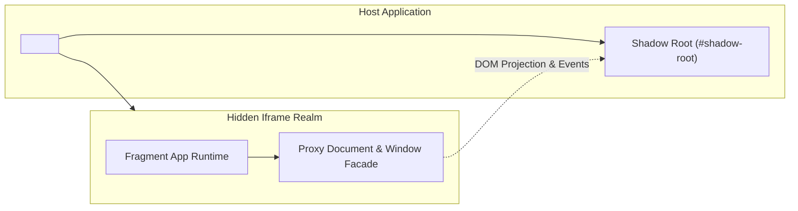

# @braidlabs/core

The foundational Braid client runtime. Compose independently deployed frontend apps into one cohesive page: one origin, one layout, and one accessibility tree, while each application retains its own isolated JavaScript realm, framework version, dependencies, and deployment schedule.

---

## Installation

```bash
npm install @braidlabs/core
```

---

## Key Primitives & Architecture



### 1. The `<fragment-slot>` Element
`<fragment-slot>` is the custom HTML element that marks insertion points in the host page. It handles:
- **Shadow Root Lifecycle:** Creates and manages open Shadow Roots (including Declarative Shadow DOM adoption from SSR piercing).
- **Realm Creation:** Spawns and manages hidden, same-origin iframe execution realms.
- **Dynamic Props & Events:** Translates host properties into the fragment and bubbles fragment events.

### 2. Execution Realms
Braid uses hidden, same-origin iframes as synchronous, DOM-capable JavaScript execution contexts:

| Realm Kind | URL Scheme | Session History Impact | Typical Use Case |
| :--- | :--- | :--- | :--- |
| `compat-http` | `/__braid/frag/:id/…` | Managed via `replaceState` | Legacy applications with zero code changes |
| `contract-blob` | `blob:` | None (Zero history pollution) | Modern contract-mode fragments |
| `sandbox` | Cross-origin URL | Isolated | Untrusted third-party widgets |

### 3. The Compat Adapter
For applications that cannot be altered during a migration, the **Compat Adapter** provides full browser emulation strictly contained inside that fragment's realm:
- **Zero Host Pollution:** Never modifies global variables (`window.*`), DOM prototypes, or listeners on the host page.
- **Document Facade:** Proxies `document.getElementById`, `querySelector`, and DOM insertions directly into the fragment's shadow root.
- **Script Neutralization:** Scripts rendered via SSR are neutralized into `<script type="inert">` so they do not execute on the host, then activated safely inside the realm.

---

## Host Integration API

Initialize Braid in your host application:

```ts
import { initBraid } from '@braidlabs/core';

// Initialize the runtime on the host page
initBraid({
  // Notify fragments on host navigation without patching host History API
  onHostNavigation: (notify) => {
    window.addEventListener('popstate', () => notify());
  },
  // Trusted fragments use the host's analytics instead of a realm-local copy
  sharedGlobals: ['dataLayer', 'adobeDataLayer', '_satellite', 'KAMPYLE'],
});
```

### Shared host globals

A compat fragment runs its JavaScript in a hidden same-origin realm. Without `sharedGlobals`, its
`window.adobeDataLayer.push(…)` goes into an array nobody watches. The usual workaround is a second
copy of the vendor script. Each listed name becomes an accessor on the fragment's realm window that
reads the host's property live and writes it back, bare identifiers included:
`var dataLayer = dataLayer || []` finds the host's array.

- **Trusted tier only.** Compat and custom-element fragments get the accessors. Untrusted
  (cross-origin) fragments ignore it, and so do contract fragments, whose host API is the contract.
- **Per fragment.** `capabilities.sharedGlobals` in the registry manifest or in
  `initBraid({ capabilities })` replaces the default. `[]` opts a fragment out.
- **Fragments can write these globals.** Initialize them on the host first.
- **It doesn't dedupe vendor scripts.** A fragment's own `<script src=".../launch.js">` still runs
  unless the fragment guards it with `if (!window._satellite)`.
- **Names the realm already defines are skipped,** with a dev-mode warning. That covers
  `location`, `document` and constructors.
- **Objects pushed from a fragment come from another realm,** so host code that checks
  `instanceof Object` on them sees `false`.
- **The accessor is configurable.** A fragment's `delete window.dataLayer` or
  `function dataLayer(){}` takes the name back into its own realm.
- **Grants ride on the realm stub,** which is cached for up to an hour. Revoking a registry grant
  reaches browsers on that schedule.

### Per-fragment storage

A compat fragment's realm is same-origin, so its `localStorage` and `sessionStorage` are the host
origin's. Two fragments whose libraries use the same fixed key, such as two OIDC clients against
different issuers, overwrite each other. Their `storage` listeners also hear each other's writes
and copy the wrong value back. `capabilities.storage` gives a fragment a store of its own:

```jsonc
"capabilities": { "storage": "partitioned" }            // its own store, keyed by fragment id
"capabilities": { "storage": { "partition": "kcd" } }   // a store shared by every fragment naming "kcd"
```

- **Zero app-code change.** The realm's `localStorage` and `sessionStorage` become views on the
  partition, and they are in place before the fragment's first script runs. Reads, writes,
  `length`, `key()`, `clear()`, named properties and `Object.keys()` see only the partition's
  entries, under their own names.
- **Events stay inside.** `storage` events, through `addEventListener` or `onstorage`, arrive
  only for the partition's keys, with the prefix removed and `storageArea` set to the
  fragment's own view. As in a native window, a fragment does not hear its own writes.
- **Named partitions share.** Fragments that use one issuer and want one login name the same
  partition. They see each other's entries and events.
- **In the real store** entries live under `braid:storage:<partition>:<key>`. A host's
  `localStorage.clear()` clears every partition too.
- **Default is `'shared'`,** exactly as before. Compat fragments only; custom-element, contract
  and untrusted fragments ignore it.
- **Turning it on starts the fragment empty.** Entries the fragment wrote while shared stay in
  the origin store under their old names. It doesn't see them, and nothing migrates or removes
  them.
- **`'partitioned'` is shorthand for `{ partition: <fragment id> }`.** So a fragment named
  `kcd` shares a store with fragments that name the partition `kcd`.
- **Small differences from a native store:**
  - `clear()` raises one `storage` event per removed entry, not one with `key === null`.
  - An event's `key` and `storageArea` are translated only while the listener runs, so read
    them before an `await`.
  - A listener attached with the original `EventTarget.prototype.addEventListener` deliberately
    goes around the filter.
- **Cookies follow the same grant.** The gateway scopes the cookies a partitioned fragment's
  backend sets and sends it only its own (see `@braidlabs/gateway`, "Per-fragment cookies"). The
  fragment's `document.cookie` shows its own cookies under their own names, plus the host's;
  cookies it writes from script go into its scope.
- **An accident barrier, not a security boundary.** Same-origin code can still reach
  `top.localStorage` and the raw cookie jar. IndexedDB, Cache Storage and BroadcastChannel are not
  partitioned.

Mounting in HTML:

```html
<!-- Mounts the billing fragment -->
<fragment-slot name="billing" trust="trusted"></fragment-slot>
```

### Shared context, and fragments that mount late

The host publishes state on the context bus. Each fragment reads it at the contract version it
declares:

```ts
// host
braidContext.set('session', { userId: 'user:ana' });

// fragment: the current value now, then every change
env.context.subscribe('session', (session) => signIn(session));
```

The bus keeps the last value of each key. A fragment's copy is seeded with every value the moment
it connects, before its code runs, and kept current by messages after that. So
`env.context.get(key)` returns the current value however late the fragment mounted. A key the
fragment may not read returns `undefined`. `subscribe` is called at once with the current value,
when there is one, and then on every change, so there is no separate `get` to remember. Pass
`replay: false` to hear only later changes. Host code's `braidContext.subscribe` behaves the same.

**Upgrading:** before this, `subscribe` fired only on later changes. Code that called `get` and then
`subscribe` now handles the first value twice. Drop the `get`, or pass `replay: false`.

The replay runs inside `subscribe`, before it returns. A listener that unsubscribes itself through
the returned function (`const off = subscribe(key, (v) => done(v) && off())`) has no `off` yet on
that first call. Use a `signal` instead:

```ts
const stop = new AbortController();
env.context.subscribe('job', (job) => job.finished && stop.abort(), { signal: stop.signal });
```

---

## Custom Element Adapter

If a fragment publishes a native Web Component / Custom Element, configure it in the manifest without full document emulation:

```json
{
  "id": "star-rating",
  "endpoint": "http://localhost:4503",
  "adapter": "custom-element",
  "entry": "/star-rating.js",
  "element": "star-rating",
  "events": ["rating:change"]
}
```

The custom element upgrades inside the isolated realm and is adopted into the host's Shadow DOM, keeping the host's `customElements` registry unpolluted.

---

## API Reference

### `initBraid(options?: InitBraidOptions): void`
Registers the `<fragment-slot>` custom element and sets up global runtime observers.

```ts
interface InitBraidOptions {
  /** What this host offers fragments, as a contract they can require a range of. */
  contract?: HostContract;
  /** Per-fragment capability grants, by fragment id. The registry's grants win where both speak. */
  capabilities?: Record<string, FragmentCapabilities>;
  /** Host globals trusted fragments share instead of a realm-local copy (see "Shared host globals"). */
  sharedGlobals?: string[];
  /** Development diagnostics: unaudited-API warnings, boundary-bypass reports, verbose boot logs. */
  dev?: boolean;
  /** Callback to wire host router navigation events to fragments. */
  onHostNavigation?: (notify: () => void) => void;
  /** The gateway's mount when the host does not own the domain root ('/manage'); must match the gateway's basePath. */
  basePath?: string;
}
```

### `FragmentSlotElement` (`<fragment-slot>`)
DOM Properties and methods on the custom element:

| Property / Method | Type | Description |
| :--- | :--- | :--- |
| `name` | `string` | The fragment ID registered in the gateway manifest. |
| `trust` | `'trusted' \| 'untrusted'` | Trust level (`'trusted'` for realm isolation; `'untrusted'` for sandboxed iframe). |
| `outlet` | attribute | Marks the slot the gateway fills with the page's routed fragment and names after it. A nameless outlet waits quietly, and boots when it is given a `name`. |
| `props` | `Record<string, unknown>` | Reactive props passed into the fragment. |
| `state` | `'idle' \| 'loading' \| 'ready' \| 'error'` | Current lifecycle state of the slot. |
| `reload()` | `() => Promise<void>` | Destroys current realm and forces a fresh network fetch & boot. |

### Events Dispatched by `<fragment-slot>`
- `braid:ready`: Dispatched when the fragment has completed booting — its code has run. It does not
  wait for the fragment's images or its window `load` event, which fires later inside the realm; a
  host that needs the fragment fully loaded should have the fragment say so with an event.
- `braid:error`: Dispatched if fragment fails to fetch or throws during boot.
- `braid:event`: Dispatched when a fragment emits a custom event to the host.
