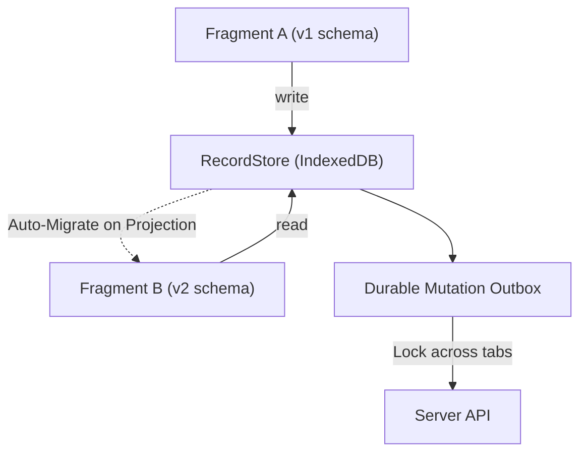

# @braidlabs/data

Framework-neutral, persistence-first client data layer with version-skew tolerance, partition isolation, and cross-realm distributed locks.

IndexedDB is the primary source of truth, and in-memory state is treated as a derived view. Every stored record is wrapped in a `@braidlabs/skew` envelope and projected to the current reader's version on read.

---

## Installation

```bash
npm install @braidlabs/data @braidlabs/skew
```

---

## Key Architecture Concepts



1. **Addressable Record Store:** Avoids read-modify-write races by storing individual addressable records per collection, rather than large monolithic blobs per key.
2. **Tenant & Partition Scoping:** Records are partitioned (e.g. `guest`, `tenant_123`, `user_456`), preventing data leaks across tenant or login boundaries.
3. **Projection on Read:** A record outlives the build that authored it. When read, the record is automatically migrated forward to the reader's declared schema version.
4. **Cross-Context Distributed Locks:** Implements `navigator.locks` across multiple iframe realms and browser tabs with reliable fallback.

---

## Usage

### Creating a Record Store

```ts
import { createRecordStore, indexedDbRecordDriver } from '@braidlabs/data';
import { UserSchema } from './user.schema';

const store = createRecordStore({
  driver: indexedDbRecordDriver({ name: 'my-app-db' }),
  partition: 'tenant_acme',
});

// Writing a versioned record
await store.put('users', 'user_1', UserSchema, {
  id: 'user_1',
  firstName: 'Grace',
  lastName: 'Hopper',
  email: 'grace@navy.mil',
  verified: true,
});

// Reading with automatic schema projection
const user = await store.get('users', 'user_1', UserSchema);
if (user) {
  console.log('Projected user:', user.firstName);
}
```

---

## Channels: state, events, and late joiners

`createEventBus` gives each channel two halves, because state is not an event:

```ts
const bus = createEventBus({ consumer: 'blotter' });
const selection = bus.channel<{ id: string }>('selection'); // scope: 'page' by default

selection.broadcast({ id: 'row-1' });             // state: last value wins
selection.subscribe((row) => highlight(row));      // called at once with the current value
await selection.emit('row.opened', { id: 'row-1' }); // an event: not replayed
```

- **State replays to late subscribers.** `subscribe` is called at once with the current value, as
  core's context bus does.
- **A context that joins late is caught up.** A fragment mounted on demand, or a new tab on an
  `'origin'` channel, asks the others for the current state the first time it reads the channel.
  The context that published it answers. If that context is gone, whichever other holder answers
  first does. The answer arrives asynchronously: `subscribe` fires when it lands, and `state()`
  returns `undefined` until then. A channel used only for events never asks.
- **Events do not replay.** A late listener does not see an `emit` that happened before it
  subscribed, which is the safe default for anything with a verb. For an event a consumer must
  not miss, use `emit(type, payload, { delivery: 'at-least-once' })` with a `driver` and the
  `consumers` list: each consumer gets its own durable queue, delivered when it next mounts.
- **Scope is how far it reaches.** `'page'` reaches every same-origin realm on this page, and no
  other tab. `'origin'` reaches every tab too. Each fragment runs in its own realm, a separate
  JavaScript context, so both travel over a `BroadcastChannel`.
  - The page is the highest same-origin document above the bus: the composed page, even when the
    app is embedded in another site.
  - It is named by when that document started. If browsers coarsen that time (Firefox's
    fingerprinting resistance rounds it to 100 ms), two tabs opened in the same instant could
    share page scope. A host that must rule this out passes its own `createEventBus({ page })`.
  - Cross-origin `trust="untrusted"` fragments are not reached.
- **A value that cannot be cloned** still reaches this context's subscribers and handlers. Its
  failure to reach other contexts is reported to `onEventError` rather than thrown.

---

## Cross-Context Distributed Locks

Coordinate actions (such as draining the mutation outbox or flushing cache) across multiple tabs and iframe realms without race conditions:

```ts
import { withLock } from '@braidlabs/data';

await withLock('flush-outbox:tenant_acme', async () => {
  // Only one tab or realm executes this block at a time
  await flushPendingMutations();
});
```

---

## API Reference

### `createRecordStore(options: RecordStoreOptions): RecordStore`

| Method | Signature | Description |
| :--- | :--- | :--- |
| `put` | `(collection, key, schema, value, owner?) => Promise<void>` | Envelopes and stores a versioned record. |
| `get` | `(collection, key, schema) => Promise<T \| null>` | Reads and projects record to target schema version. |
| `delete` | `(collection, key) => Promise<void>` | Removes a record by key. |
| `list` | `(collection, schema) => Promise<T[]>` | Lists all records in the partition, ordered by sequence. |
| `clearPartition` | `(collection) => Promise<void>` | Clears all records for current partition (e.g. on logout). |

### Storage Drivers
- `indexedDbRecordDriver(options: IndexedDbDriverOptions)`: Production persistent IndexedDB driver.
- `memoryRecordDriver()`: In-memory driver for unit testing and ephemeral sessions.
