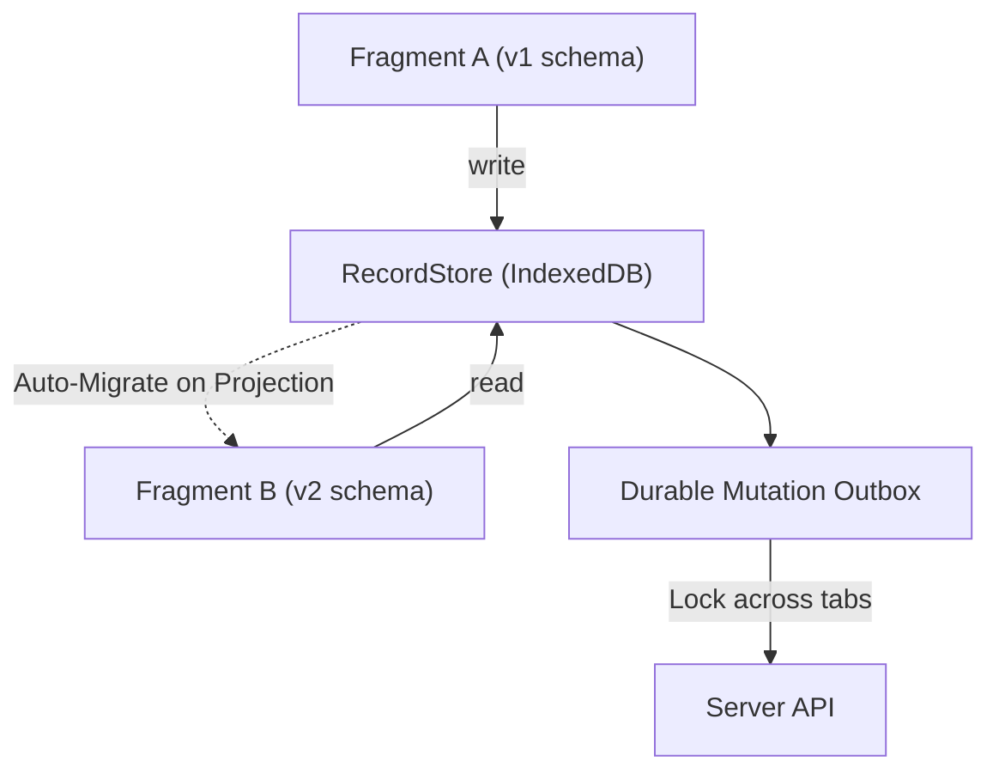

# @braidlabs/data

Framework-neutral, persistence-first client data layer with version-skew tolerance, partition isolation, and cross-realm distributed locks.

IndexedDB is the primary source of truth, and in-memory state is treated as a derived view. Every stored record is wrapped in a `@braidlabs/skew` envelope and projected to the current reader's version on read.

---

## Installation

```bash
npm install @braidlabs/data @braidlabs/skew
```

---

## Key Architecture Concepts



1. **Addressable Record Store:** Avoids read-modify-write races by storing individual addressable records per collection, rather than large monolithic blobs per key.
2. **Tenant & Partition Scoping:** Records are partitioned (e.g. `guest`, `tenant_123`, `user_456`), preventing data leaks across tenant or login boundaries.
3. **Projection on Read:** A record outlives the build that authored it. When read, the record is automatically migrated forward to the reader's declared schema version.
4. **Cross-Context Distributed Locks:** Implements `navigator.locks` across multiple iframe realms and browser tabs with reliable fallback.

---

## Usage

### Creating a Record Store

```ts
import { createRecordStore, indexedDbRecordDriver } from '@braidlabs/data';
import { UserSchema } from './user.schema';

const store = createRecordStore({
  driver: indexedDbRecordDriver({ name: 'my-app-db' }),
  partition: 'tenant_acme',
});

// Writing a versioned record
await store.put('users', 'user_1', UserSchema, {
  id: 'user_1',
  firstName: 'Grace',
  lastName: 'Hopper',
  email: 'grace@navy.mil',
  verified: true,
});

// Reading with automatic schema projection
const user = await store.get('users', 'user_1', UserSchema);
if (user) {
  console.log('Projected user:', user.firstName);
}
```

---

## Channels: state, events, and late joiners

`createEventBus` gives each channel two halves, because state is not an event:

```ts
const bus = createEventBus({ consumer: 'blotter' });
const selection = bus.channel<{ id: string }>('selection'); // scope: 'page' by default

selection.broadcast({ id: 'row-1' });             // state: last value wins
selection.subscribe((row) => highlight(row));      // called at once with the current value
await selection.emit('row.opened', { id: 'row-1' }); // an event: not replayed
```

- **State replays to late subscribers.** `subscribe` is called at once with the current value, as
  core's context bus does.
- **A context that joins late is caught up.** A fragment mounted on demand, or a new tab on an
  `'origin'` channel, asks the others for the current state the first time it reads the channel.
  The context that published it answers. If that context is gone, whichever other holder answers
  first does. The answer arrives asynchronously: `subscribe` fires when it lands, and `state()`
  returns `undefined` until then. A channel used only for events never asks.
- **Events do not replay.** A late listener does not see an `emit` that happened before it
  subscribed, which is the safe default for anything with a verb. For an event a consumer must
  not miss, use `emit(type, payload, { delivery: 'at-least-once' })` with a `driver` and the
  `consumers` list: each consumer gets its own durable queue, delivered when it next mounts.
- **Scope is how far it reaches.** `'page'` reaches every same-origin realm on this page, and no
  other tab. `'origin'` reaches every tab too. Each fragment runs in its own realm, a separate
  JavaScript context, so both travel over a `BroadcastChannel`.
  - The page is the highest same-origin document above the bus: the composed page, even when the
    app is embedded in another site.
  - It is named by when that document started. If browsers coarsen that time (Firefox's
    fingerprinting resistance rounds it to 100 ms), two tabs opened in the same instant could
    share page scope. A host that must rule this out passes its own `createEventBus({ page })`.
  - Cross-origin `trust="untrusted"` fragments are not reached.
- **Values are cloned.** Each subscriber, handler and other context gets its own structured clone,
  so nobody can change what another sees. A value that cannot be cloned (one holding a function,
  say) is not delivered, and the failure is reported to `onEventError` rather than thrown from
  `broadcast` or `emit`.

### State that survives a reload

`persist: true` keeps a channel's state in the bus's `driver`, for example IndexedDB:

```ts
const driver = indexedDbRecordDriver({ database: 'app', collections: [...EVENT_BUS_COLLECTIONS] });
const bus = createEventBus({ consumer: 'blotter', driver });
const selection = bus.channel('selection', { persist: true });
selection.subscribe((row) => highlight(row)); // after a reload: the row selected before it
```

- **What's stored:** the last value this context broadcast, per partition. When a contract is
  registered for the channel (`bus.register`), it's stored as a versioned envelope, so a newer or
  older build reads it at its own version. `broadcast(undefined)` clears it.
- **Freshness:** a stored value is a fallback. A value broadcast since the reload wins over it, and
  so does a fresher value another context holds.
- **Timing:** restoring is asynchronous. `subscribe` fires when the value is read, and `state()` is
  `undefined` until then.
- **Without a `driver`:** `persist` throws rather than quietly forgetting. An IndexedDB driver
  must list `EVENT_BUS_COLLECTIONS` among its collections, as durable events need too.
- **Sign-out purges it only if told to.** Stored state can identify what someone was looking at.
  List the same collections in `createTenancy({ collections: [...yours, ...EVENT_BUS_COLLECTIONS] })`
  so `signOut()` removes them with everything else.
- **Register contracts first.** Call `bus.register(name, contract)` before opening a persisted
  channel. A value stored under a contract that this build hasn't registered is reported and not
  handed over, because its shape could belong to another version.
- **Open it the same way everywhere.** A channel's options are fixed by its first `channel()` call
  in a context. Opening it again with a different `persist` or `scope` throws.
- **Failures are reported, not thrown.** A value that can't be stored (not cloneable, no partition
  active after sign-out, a failing driver) still goes out as a broadcast, and the failure goes to
  `onEventError`.

## Intents across fragments

`addIntentListener` and `raiseIntent` mean "somebody on this page, handle this". With a page (see
scope above), a handler registered in one fragment's realm is a candidate for a raise in another's:

```ts
// in the billing fragment
bus.addIntentListener('ViewInvoice', { handler: async ({ id }) => openInvoice(id), priority: 1 });

// in the blotter fragment, a separate realm
const { handled } = await bus.raiseIntent('ViewInvoice', { id: 'o1' });
```

- **One ranking.** Handlers here and in other realms are ranked together. The `'first'`, `'all'`,
  `'ask'` and custom policies, and `candidates()`, see one list. Each candidate from another realm
  carries a `source`.
- **Versions are the raiser's call.** Whether a handler can read the payload, and the projection to
  the version it declared with `as`, are decided where the intent is raised, so register the
  intent's contract (`bus.register`) in every fragment that raises it. A handler in another realm
  that declares `as` isn't offered to a raiser with no contract to project with. An older fragment
  never receives a shape it can't read, and never runs migration code.
- **Results and errors come back.** A handler's return value resolves the raise, and a thrown error
  rejects it. Both cross as structured clones: a result can't hold functions, and an error arrives
  as its message, rebuilt as `NoIntentHandlerError` when it was one. A local handler's result is
  returned as is.
- **A realm that goes away stops being offered.** A bus that closes, or whose page is hidden or
  unloaded (including into the back-forward cache, which says hello again on return), leaves the
  directory, and raises waiting on it reject immediately. A realm that dies without a word (a
  crashed or frozen frame) is dropped the first time a call to it times out, after
  `intentTimeoutMs`, which defaults to 30 seconds.
- **Discovery is asynchronous.** Each bus learns about the others' handlers by message. A raise that
  finds nobody in a bus's first 100 ms waits for the directory once before giving up, so a fragment
  can raise as it mounts.
- **Page scope only.** Another tab's handlers are not candidates, subject to the page-identity
  caveat above; pass `page` to rule it out. Without a page (outside a browser, unless `page` is
  passed), intents stay within the bus.
- **The page's same-origin realms trust each other.** Any same-origin script can write to the
  page's channels, so a call to a handler in another realm is code running on that realm's behalf.
  Malformed messages are dropped and an answer is only taken from the realm the call went to, but
  this is not a security boundary: put untrusted code in a `trust="untrusted"` fragment, which can't
  reach these channels.
- **One partition per bus.** A bus joins its partition's channels when it is created. After a
  tenant switch, create a new bus for the new partition rather than reusing the old one.

---

## Cross-Context Distributed Locks

Coordinate actions (such as draining the mutation outbox or flushing cache) across multiple tabs and iframe realms without race conditions:

```ts
import { withLock } from '@braidlabs/data';

await withLock('flush-outbox:tenant_acme', async () => {
  // Only one tab or realm executes this block at a time
  await flushPendingMutations();
});
```

---

## API Reference

### `createRecordStore(options: RecordStoreOptions): RecordStore`

| Method | Signature | Description |
| :--- | :--- | :--- |
| `put` | `(collection, key, schema, value, owner?) => Promise<void>` | Envelopes and stores a versioned record. |
| `get` | `(collection, key, schema) => Promise<T \| null>` | Reads and projects record to target schema version. |
| `delete` | `(collection, key) => Promise<void>` | Removes a record by key. |
| `list` | `(collection, schema) => Promise<T[]>` | Lists all records in the partition, ordered by sequence. |
| `clearPartition` | `(collection) => Promise<void>` | Clears all records for current partition (e.g. on logout). |

### Storage Drivers
- `indexedDbRecordDriver(options: IndexedDbDriverOptions)`: Production persistent IndexedDB driver.
- `memoryRecordDriver()`: In-memory driver for unit testing and ephemeral sessions.
