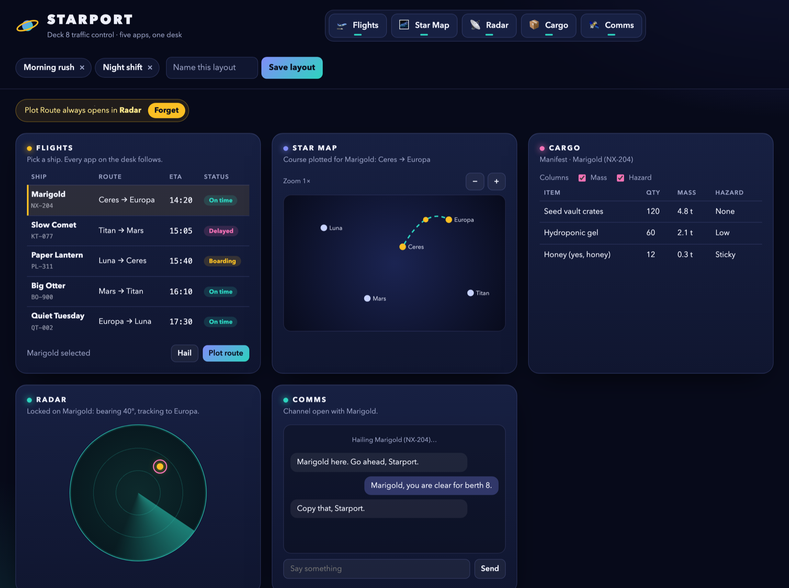
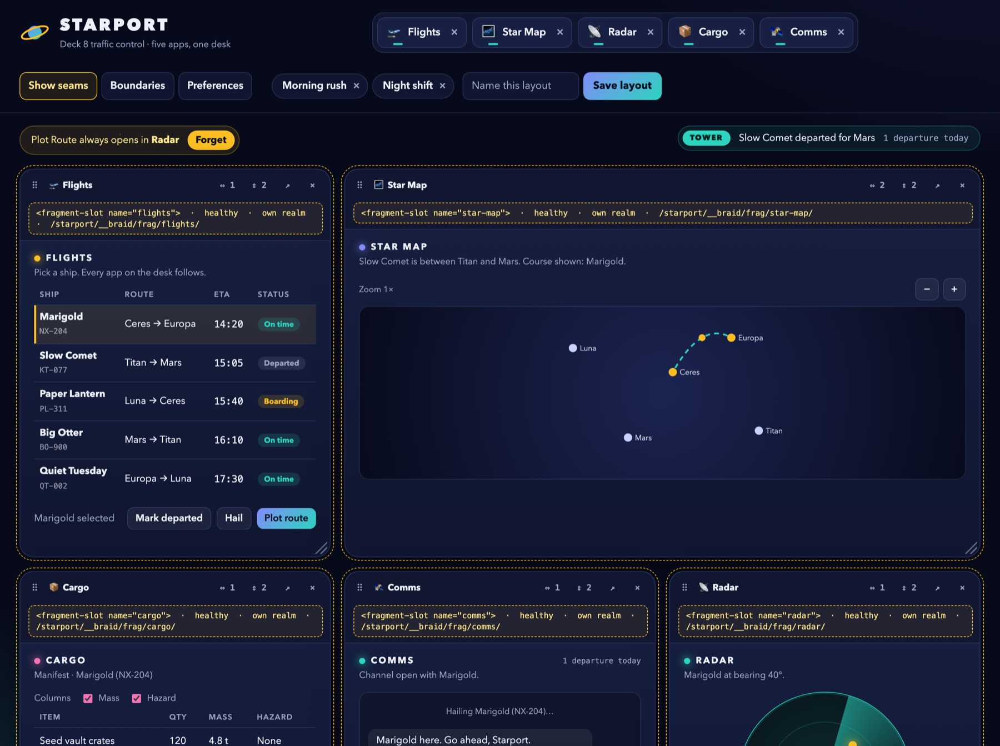
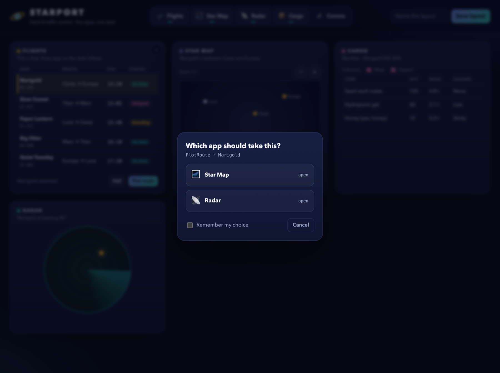
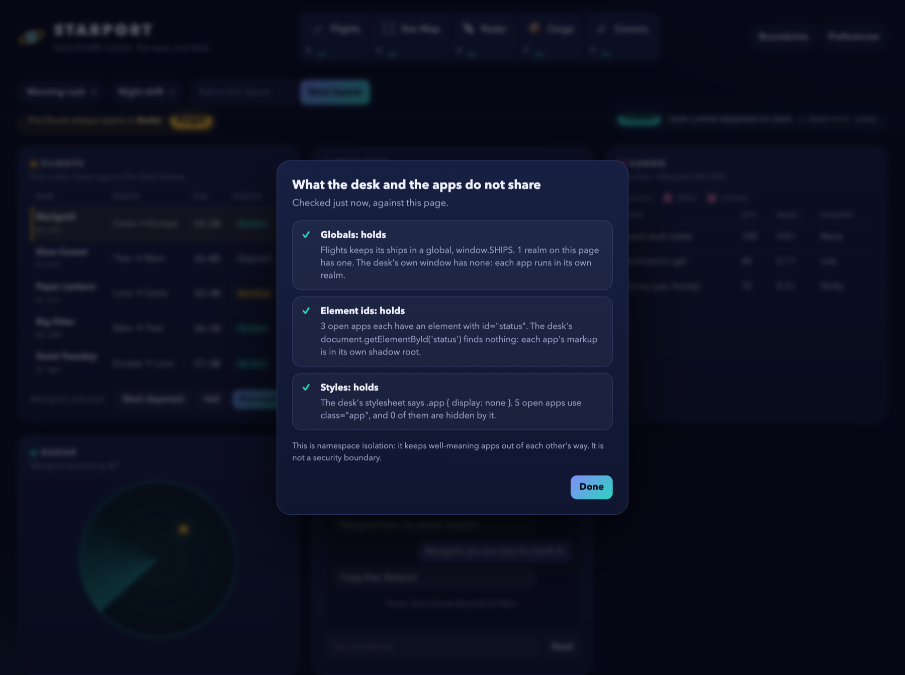
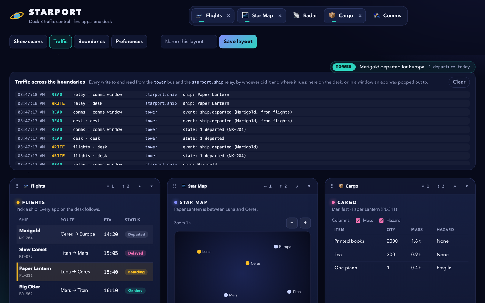

# Starport — a Braid workspace, as static files

Five small apps on one desk: a flight board, a star map, a radar, a cargo manifest and a comms
panel. Each is a plain static app that knows nothing about the others. The desk is a
[console workspace](../../docs/packages/console.md#the-workspace) around an
[FDC3 agent](../../docs/packages/fdc3.md), and the whole thing is a folder of files: the Braid
gateway runs in the page's service worker.

**Live:** <https://braidjs.github.io/braid/starport/>



## What it shows

- **No server gateway.** `sw.js` is the gateway (`@braidlabs/sw/gateway`). The host only serves
  files, from a subfolder: Braid's own URLs live under it, at `/starport/__braid/…`.
- **Boundaries.** Each app runs in its own realm and renders in its own shadow root. The
  *Boundaries* panel checks three consequences against the live page: Flights' `window.SHIPS` is
  in its realm and not on the desk's window, apps reuse an element id the desk's document cannot
  find, and a desk style rule aimed at the class every app uses hides none of them. This is
  namespace isolation between apps that trust each other, not a security boundary: see
  [trust tiers](../../docs/braid-boundary.md).
- **A pick followed everywhere.** Choose a ship in Flights. Star Map and Cargo show it, because
  every app joins the same FDC3 channel before its code runs.
- **An intent two apps can take.** *Plot route* doesn't name an app. Star Map and Radar both take
  `PlotRoute`, so the desk asks. Tick *Remember my choice* and it stops asking; *Forget* undoes that.
- **An app launched for a raise.** *Hail* raises `HailShip`. Only Comms takes it, so Comms is
  opened if it isn't already, and gets the ship.
- **An event bus.** *Mark departed* emits `ship.departed` on a `@braidlabs/data` channel. The
  desk's ticker and Comms hear it. Which ships have left is the channel's state: a Comms or a
  Flights opened afterwards gets that, and does not get the old event replayed. The channel reaches
  every window of the origin, so an app popped out to a window hears departures, and a Flights out
  in a window can mark them.
- **Traffic across the boundaries.** *Traffic* opens a live log of what crosses: every write to and
  read from the `tower` bus and the `starport.ship` relay, by whoever did it (an app, the desk, or
  the relay), and where it runs — on the desk, or in the window an app was popped out to. FDC3
  broadcasts and intents within a page are not logged. Pop out Comms, mark a ship departed, and watch Flights write on the
  desk and Comms read in its window. Open a Comms afterwards and it logs a state read and no
  event: state is replayed to a late reader, events are not. The apps report their own traffic to a
  `starport.traffic` channel ([`src/traffic.js`](./src/traffic.js)); the bus itself has no tap, so
  the log is what each page says it did, and any page of this origin could add to it.
- **Seams.** *Show seams* outlines every tile and labels it with its `<fragment-slot>` tag, its
  state, and the URL the worker served it from, as the Braid site's "Show the seams" does for its
  sections.
- **Tiles you arrange.** Drag a tile by its grip (⠿) to move it, by mouse or touch, or press Alt and
  an arrow key on the grip. The app keeps running while it moves. Drag a tile's right edge, bottom
  edge or corner to span up to three columns and three rows: an outline shows the size it snaps to,
  and Escape cancels. The ⇔ and ⇕ buttons and Shift+Alt+arrows do the same. On a phone every tile
  is full width. All of this, and popping out, is
  [`@braidlabs/console/tiles`](../../docs/packages/console.md#tiles-move-resize-pop-out): the
  desk adds only its seam line and its look.
- **Pop out.** ↗ moves an app into a window of its own, with its state. It still follows the ship
  picked on the desk, and closing the window puts it back on the desk as it was left. Cmd-click
  (Ctrl-click) opens a copy in a tab instead, and leaves the desk alone.
- **Layouts that keep each app's state, order and size.** Zoom the map, widen it, move it, save a
  layout. Close things, restore it: the apps come back in that order and size, and the map is
  zoomed as it was. Layouts survive a reload.
- **Preferences and app settings.** *Preferences* hides an app from the chooser: hide Radar and
  *Plot route* goes straight to Star Map. Cargo's column choice is a setting kept for the app.
  Both are the same after a reload.









Which to use when — a channel, an intent, or an event — is the subject of the
[events and data guide](../../docs/events-and-data.md).

## Files

- `src/registry.js` — the five apps: where each is, and which intents it raises and takes. The
  worker and the desk both read it.
- `src/sw.js` — the whole worker: `setupBraidGateway` with that registry.
- `src/main.js` — the desk's runtime: it registers the worker, then the workspace, the agent, the
  dock, the tiles (`arrange` from `@braidlabs/console/tiles`), layouts, the chooser, the ticker,
  the two panels, and the window an app is popped out to (`acceptPopOut`).
- `public/shell` — the desk's page and its theme. The palette is CSS custom properties, which
  cross into each app's shadow root.
- `public/apps/*` — the five apps. They use `fdc3` and, for settings and layout state,
  `braidDesktop`; both exist before an app's first script runs. Flights and Comms also import
  `@braidlabs/data` for the event bus.
- `build.mjs` — writes the deployable folder. `server.mjs` — a plain static server for it.

## Running it

```bash
npm install
npm start
```

Open `http://127.0.0.1:3000/starport/`.

That needs the 0.8.0 packages, the first with `@braidlabs/console/workspace`. From a Braid checkout,
or before 0.8.0 is published, build against the sources instead:

```bash
BRAID_TSCONFIG=../../tsconfig.base.json node server.mjs
```

The repository's e2e (`e2e/starport-example.e2e.ts`) builds this example and runs it in Chromium.

## Hosting it

```bash
npm run build
```

`dist/` is the deployment. Put it on any static host over https, at the root or in a subfolder;
the desk works out where it is from its own URL. This repository publishes it with its docs, on
GitHub Pages. `--out` names another folder; the build clears it first, so it refuses one that is
not empty unless an earlier build wrote it.

Two things a host must not get in the way of:

- **The service worker.** `sw.js` has to be served from the desk's folder, as JavaScript.
- **Frames from the same origin.** Each app's realm is a same-origin frame, so a
  `Content-Security-Policy` on the desk's page needs `frame-src 'self'`.

On an origin shared with other pages, those pages can read and write the same `localStorage`. The
desk keeps its entries under its own folder's name, which stops accidents, not a hostile page.

## Limits

- The first visit paints the empty desk for a moment, until the worker is in control. Where
  service workers are unavailable (some private windows) the desk says so and stays empty.
- A tab left open across a deploy keeps the worker it loaded with until it is closed, so a new
  build's desk can briefly run against the previous build's registry.
- Everything the user keeps is in `localStorage`, so it is per browser. A server gateway with
  `preferences` and a `serverStore` keeps it per signed-in user instead.
- Under a `basePath` the gateway does not serve the app directory yet, so the desk writes its
  FDC3 records from the registry itself.
- The gateway's policies run on the user's device, so they are advisory. See "The gateway in the
  worker" in the [`@braidlabs/sw` README](../../libs/braid-sw/README.md).
- The tiles are a grid: an app has a place in an order and a span, not an x and y of its own.
- A popped-out window has its own FDC3 agent. The desk relays the selected ship to it over a
  `@braidlabs/data` channel scoped to the origin. The Tower and the traffic log are scoped to the
  origin too, so two desks open in two tabs share one departures board, and each desk's Traffic
  panel shows the other's traffic as well, labelled only `desk` or `<app> window`.
  A saved layout holds the desk, not apps that are out in windows.
- A popped-out app's state crosses between windows through `localStorage` and a
  `BroadcastChannel`, in the clear, to any page of this origin. Fine for Starport; think before
  carrying anything private that way. A window that does not take its app within ten seconds gives
  it back to the desk. Reloading a popped-out window keeps the app in it.
- A popped-out app comes back with its state from a moment after its last change: an app that
  changes by itself is caught up every few seconds, so a window closed straight after such a change
  can miss it.
